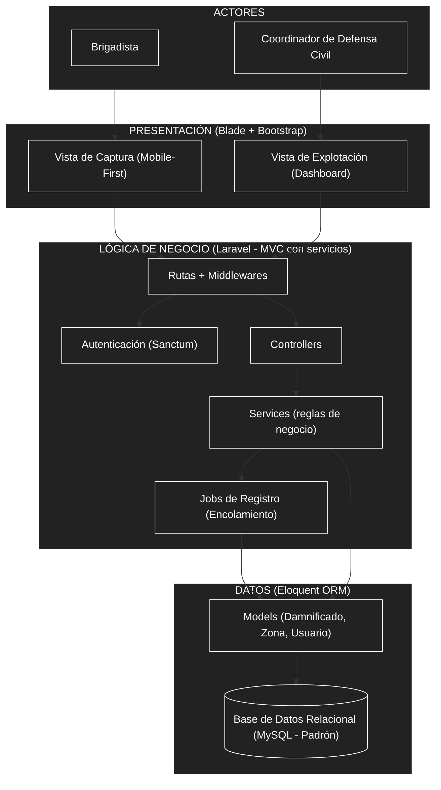

# Arquitectura Inicial

## Diagrama de la Arquitectura Inicial

## Descripción de la Arquitectura Inicial

La solución es un **monolito Laravel** con presentación en servidor (Blade), separado en capas y con procesamiento asíncrono para soportar alta demanda:

* **Presentación (Blade + Bootstrap):** Ofrece la *Vista de Captura* (Mobile-First para brigadistas en campo) y el *Dashboard* (explotación de datos para coordinadores), renderizadas por el servidor.
* **Lógica de Negocio (Laravel):** Rutas y middlewares validan el token de *Sanctum*, los *controllers* coordinan la petición y los *services* concentran las reglas de validación y consolidación del padrón. El registro masivo pasa por *Jobs de Registro (Laravel Queues)* para procesar picos de hasta 3,000 usuarios sin saturar el sistema.
* **Datos (Eloquent + MySQL):** Garantiza la persistencia, normalización e integridad del padrón único de damnificados mediante modelos Eloquent sobre MySQL.
