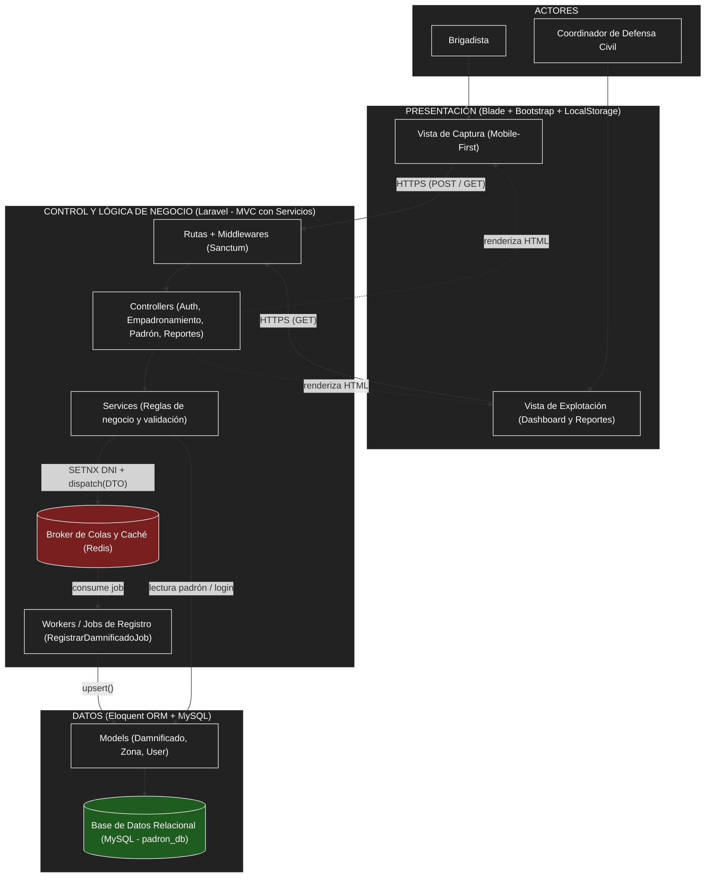

# Arquitectura Inicial

## Diagrama de la Arquitectura Inicial

## Descripción de la Arquitectura Inicial

La solución se estructura como un **Monolito Modular en Laravel** con renderizado en servidor (**Blade**), organizado en capas y respaldado por **Redis** y **MySQL** para absorber picos de alta concurrencia:

* **Presentación (Blade + Bootstrap + JS LocalStorage):** Ofrece la *Vista de Captura* (*Mobile-First* con persistencia temporal en el navegador ante microcortes de señal) para los brigadistas en campo y el *Dashboard* de explotación para los coordinadores de Defensa Civil.
* **Control y Lógica de Negocio (Laravel + Redis):** Las rutas y middlewares validan el token de **Laravel Sanctum**; los *controllers* coordinan la petición HTTP y delegan en los *services*. En el registro masivo, `EmpadronamientoService` valida el DNI y verifica duplicados atómicamente en **Redis** (`SETNX`), despachando un DTO ligero a la cola en memoria para que los *Workers* (`RegistrarDamnificadoJob`) procesen hasta 3,000 registros concurrentes sin saturar el motor relacional.
* **Datos (Eloquent + MySQL):** Los *workers* persisten de forma controlada e idempotente (`upsert`) a través de los modelos **Eloquent** sobre **MySQL (`padron_db`)**, garantizando la normalización y la restricción física de unicidad del DNI (`UNIQUE`).
