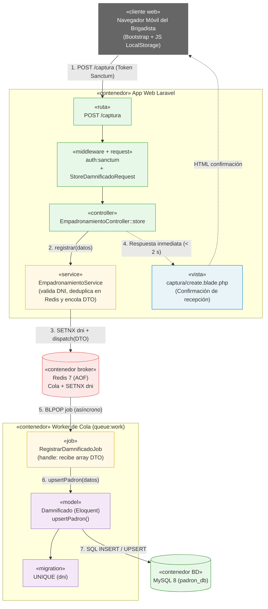

# Componentes Arquitectónicos

Descomposición del monolito Laravel en los componentes que conforman cada capa y su interacción con **Redis** y **MySQL** para atender el caso de uso crítico: *registrar a un damnificado en condiciones de alta concurrencia (3,000 brigadistas simultáneos)*.

## 1. Inventario de Componentes

| Componente | Carpeta / Ubicación | Responsabilidad |
| :--- | :--- | :--- |
| **Rutas** | `routes/web.php`, `routes/api.php` | Mapean URLs a controllers y declaran los middlewares aplicados. |
| **Middlewares y Requests** | `app/Http/Middleware/`, `app/Http/Requests/` | Validan el token de **Laravel Sanctum**, permisos de rol y formato de entrada (`StoreDamnificadoRequest`) antes de llegar al controller. |
| **Controllers** | `app/Http/Controllers/` | Reciben la petición HTTP, delegan en la interfaz del *service* y devuelven la vista Blade o confirmación HTTP `202 Accepted`. Sin reglas de negocio. |
| **Services** | `app/Services/` | Concentran las reglas de negocio: validación de DNI, deduplicación atómica en **Redis**, despacho de DTO a la cola, consolidación y métricas del padrón. |
| **Jobs** | `app/Jobs/` | Unidades de trabajo serializables (`RegistrarDamnificadoJob`) consumidas desde **Redis** por los procesos `queue:work` para persistir en MySQL. |
| **Models (Eloquent)** | `app/Models/` | Representan las entidades (`Damnificado`, `Zona`, `User`) y ejecutan operaciones `upsert` y consultas sobre **MySQL**. |
| **Migrations** | `database/migrations/` | Definen el esquema relacional: claves primarias, restricción física `UNIQUE (dni)` y claves foráneas a `zonas`. |
| **Vistas (Blade)** | `resources/views/` | Presentación renderizada en servidor con Bootstrap: formulario de captura *Mobile-First* (con respaldo en `localStorage`) y dashboard del coordinador. |

## 2. Diagrama de Componentes (Flujo de Registro de Damnificado)

## 3. Flujo Resumido de Alta Concurrencia

1. **Envío desde campo:** El brigadista envía el formulario desde su navegador móvil; si hay microcorte de señal, el cliente conserva el registro en `localStorage` hasta confirmar recepción.
2. **Validación de entrada y autenticación:** El middleware `auth:sanctum` y `StoreDamnificadoRequest` validan el token y la estructura de los campos antes de invocar al controlador.
3. **Deduplicación en memoria y encolamiento (`< 5 ms`):** `EmpadronamientoController::store` delega en `EmpadronamientoService`, el cual comprueba atómicamente el DNI en **Redis** (`SETNX dni:{numero}`) y despacha `RegistrarDamnificadoJob` con el arreglo de datos (`DTO`) hacia la cola en Redis, **sin abrir conexiones de escritura contra MySQL**.
4. **Respuesta inmediata al brigadista:** El controlador devuelve de inmediato la vista de confirmación (`< 2 s`), liberando al brigadista para continuar empadronando.
5. **Persistencia asíncrona controlada:** Los contenedores *Worker* (`php artisan queue:work`) consumen los jobs desde Redis y ejecutan `Damnificado::upsertPadron()` sobre **MySQL**, donde el índice `UNIQUE (dni)` actúa como garantía física definitiva de integridad del padrón.
