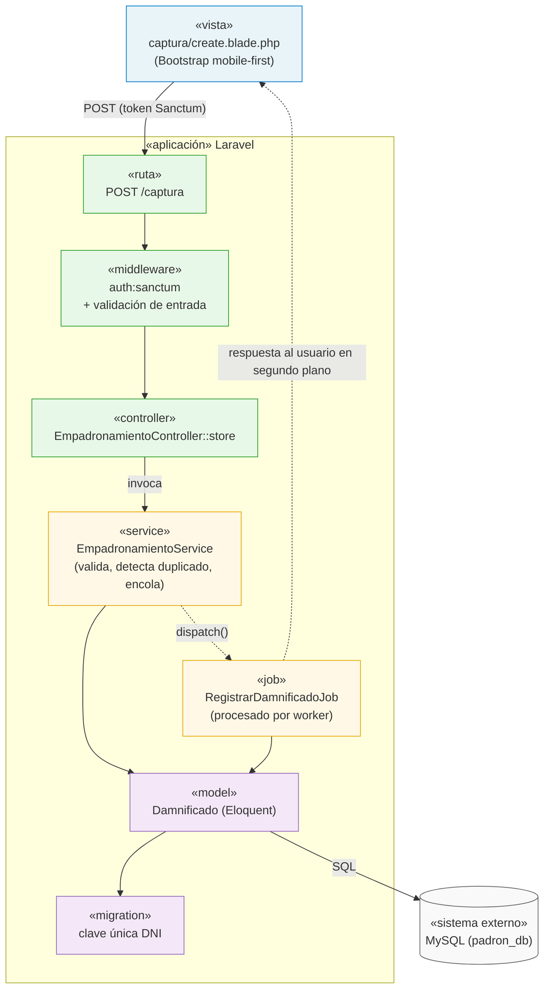

# Componentes Arquitectónicos

Descomposición del monolito Laravel en los componentes que conforman cada capa, y cómo interactúan entre sí para atender el caso de uso principal: *registrar a un damnificado en el padrón*.

## 1. Inventario de Componentes

| Componente | Carpeta en Laravel | Responsabilidad |
|---|---|---|
| Rutas | `routes/web.php`, `routes/api.php` | Mapean URLs a controllers y declaran los middlewares aplicados. |
| Middlewares | `app/Http/Middleware/` | Validan el token Sanctum, permisos y formato de la entrada antes de llegar al controller. |
| Controllers | `app/Http/Controllers/` | Reciben la petición, delegan en un service y devuelven la vista o JSON. Sin reglas de negocio. |
| Services | `app/Services/` | Concentran las reglas de negocio: validación del DNI, detección de duplicados, consolidación y métricas del padrón. |
| Jobs | `app/Jobs/` | Unidades de trabajo encolables (`RegistrarDamnificadoJob`) ejecutadas por los workers de Laravel Queues. |
| Models (Eloquent) | `app/Models/` | Representan las entidades (Damnificado, Zona, User) y su relación con las tablas de MySQL. |
| Migrations | `database/migrations/` | Definen el esquema relacional: claves primarias, clave única del DNI y claves foráneas a zonas. |
| Vistas (Blade) | `resources/views/` | Presentación en servidor con Bootstrap: formulario de captura mobile-first y dashboard del coordinador. |

## 2. Diagrama de Componentes (Registro de Damnificado)

## 3. Flujo resumido

1. El brigadista envía el formulario desde el navegador móvil; el token Sanctum viaja en la cabecera.
2. El middleware valida el token y el formato de los datos; si falla, se redirige con errores de validación.
3. El controller delega en `EmpadronamientoService`, que aplica las reglas de negocio (DNI válido, sin duplicado).
4. El servicio registra el trabajo mediante `RegistrarDamnificadoJob` (encolamiento) y responde de inmediato.
5. El worker procesa el job, persiste con Eloquent en MySQL y el padrón consolidado queda disponible para el dashboard y los reportes.
