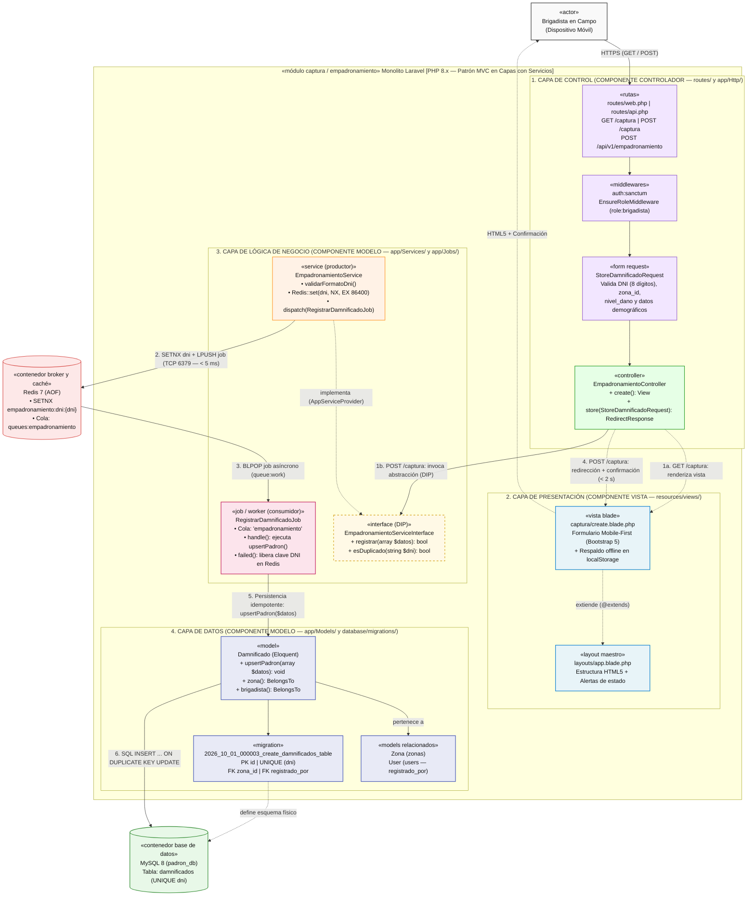

# Enfoque Arquitectónico: MVC en Capas con Servicios

## 1. Justificación del Enfoque

Para el **Sistema Transaccional de Empadronamiento**, se ha adoptado el enfoque de **MVC (Modelo-Vista-Controlador) con una capa intermedia de servicios** dentro del framework Laravel, complementado con **procesamiento asíncrono sobre Redis**. Mientras que el patrón MVC tradicional suele acoplar las reglas de negocio a los controladores o a los modelos ORM, la capa explícita de *services* e interfaces mantiene las reglas del padrón independientes del transporte HTTP.

| Elemento | Descripción aplicada al Sistema de Empadronamiento |
| :--- | :--- |
| **Patrón / Enfoque** | MVC (Modelo-Vista-Controlador) con capa de servicios intermedia y cola asíncrona (*Productor-Consumidor*). |
| **Objetivo** | Lograr que las dependencias apunten siempre hacia las abstracciones de negocio (`EmpadronamientoServiceInterface`), desacoplando la recepción HTTP de la escritura en base de datos. |
| **¿Qué problema resuelve?** | Evita el acoplamiento entre las reglas del padrón y los detalles técnicos (HTTP, Blade, MySQL, Redis) y elimina el bloqueo de MySQL durante ráfagas de 3,000 brigadistas concurrentes (`DA01`, `DA06`). |
| **Capas MVC definidas** | **1. Control (Componente Controlador):** Rutas, Middlewares (`auth:sanctum`, `EnsureRoleMiddleware`), `StoreDamnificadoRequest` y `EmpadronamientoController`. **2. Presentación (Componente Vista):** Plantillas Blade (`captura/create.blade.php` y `layouts/app.blade.php`) con Bootstrap 5 y `localStorage`. **3. Lógica de Negocio (Componente Modelo):** `EmpadronamientoServiceInterface`, `EmpadronamientoService` y `RegistrarDamnificadoJob`. **4. Datos (Componente Modelo):** Modelos Eloquent (`Damnificado`, `Zona`, `User`) y migraciones sobre MySQL. |
| **Beneficios** | Código testeable mediante inversión de dependencias (DIP), respuestas HTTP `< 2 s` al encolar en memoria (`Redis`) y cero duplicados mediante validación atómica `SETNX` + restricción física `UNIQUE (dni)` en MySQL. |

---

## 2. Diagrama de Capas (Módulo Empadronamiento)

---

## 3. Reglas de Dependencia entre las Capas MVC

1. **Flujo HTTP y Presentación (`Controlador → Vista`):** Las peticiones HTTP entran siempre por la capa de **Control** (`Rutas` → `Middleware auth:sanctum` + `EnsureRoleMiddleware` → `StoreDamnificadoRequest` → `EmpadronamientoController`). El controlador invoca al contrato del *service* y finalmente renderiza la vista **Blade** (`captura/create.blade.php`); la vista jamás contiene lógica de negocio ni consultas SQL.
2. **Controladores Delgados e Inversión de Dependencias (`Controlador → Interfaz del Modelo`):** `EmpadronamientoController` depende exclusivamente de la interfaz `EmpadronamientoServiceInterface` (registrada en `AppServiceProvider`): no conoce si el registro se encola en Redis o se guarda síncronamente, ni accede directamente a Eloquent.
3. **Servicios Independientes de HTTP (`Modelo - Negocio`):** `EmpadronamientoService` recibe un arreglo validado (`array $datos`), verifica el formato del DNI, reserva atómicamente la clave `empadronamiento:dni:{dni}` en **Redis** (`SETNX`) y despacha `RegistrarDamnificadoJob` a la cola `empadronamiento` en `< 5 ms`.
4. **Flujo Unidireccional en Jobs (`Modelo - Cola → Modelo - Datos`):** `RegistrarDamnificadoJob` es consumido desde Redis por el contenedor *Worker* (`queue:work`) y persiste directamente a través de `Damnificado::upsertPadron($datos)`, sin volver a invocar a `EmpadronamientoService`. Si agota sus 3 reintentos (`failed()`), libera la clave de reserva en Redis para permitir el reenvío.
5. **Integridad en Capa de Datos (`Modelo - Datos → MySQL`):** El modelo Eloquent `Damnificado` y la migración `2026_10_01_000003_create_damnificados_table.php` son la única puerta hacia **MySQL**, resguardando la restricción física `UNIQUE (dni)` y las relaciones con `Zona` y `User`.
