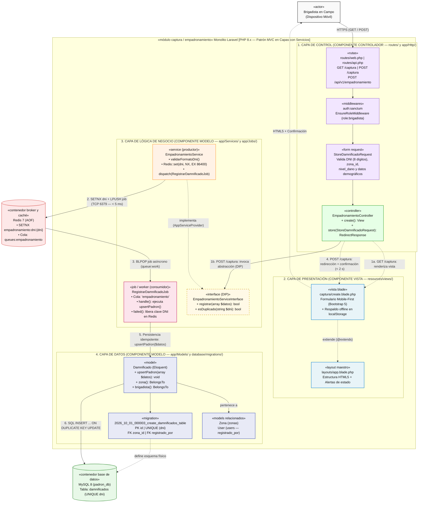

# Enfoque Arquitectónico: MVC en Capas con Servicios y Tácticas de Alta Concurrencia

## 1. Justificación del Enfoque Arquitectónico

Mientras que el **Patrón Arquitectónico** define la estructura estática del sistema, el **Enfoque Arquitectónico** establece la **estrategia de diseño y las tácticas técnicas** mediante las cuales la arquitectura satisface los **Drivers Arquitectónicos (`DA01`–`DA06`)**, los **Atributos de Calidad (`AC01`–`AC06`)** y las **Restricciones (`RC01`–`RC07`)**.

Para el **Sistema Transaccional de Respuesta Rápida para el Empadronamiento**, el enfoque se fundamenta en tres pilares estratégicos dentro del ecosistema Laravel:

1. **Separación Estricta MVC + Capa de Servicios (`ADR-002`):** A diferencia del MVC tradicional (donde los controladores o modelos Eloquent suelen acumular validaciones y lógica de dominio), se introduce una subcapa explícita de **Servicios (`app/Services/`)**. Los controladores quedan reducidos a orquestadores HTTP delgados y las vistas Blade a plantillas declarativas.
2. **Inversión de Dependencias Pragmática (`DIP` en la Ruta Crítica):** En el módulo transaccional de alta concurrencia (**Captura / Empadronamiento**), el controlador depende exclusivamente del contrato [`EmpadronamientoServiceInterface`](../../app/Services/Contracts/EmpadronamientoServiceInterface.php) (registrado en [`AppServiceProvider`](../../app/Providers/AppServiceProvider.php)). Por pragmatismo arquitectónico (*principio YAGNI*), los módulos de consulta y autenticación (`AuthService`, `PadronService`, `ReporteService`) se inyectan directamente como clases concretas para evitar sobreingeniería innecesaria en flujos de baja contención.
3. **Desacoplamiento Temporal Asíncrono (`ADR-003`):** Para absorber ráfagas de hasta **3,000 brigadistas simultáneos** sin agotar el pool de conexiones de MySQL, la ruta de escritura desacopla la recepción HTTP de la persistencia relacional utilizando **Redis 7** como broker en memoria y **Laravel Queues** (`RegistrarDamnificadoJob`).

| Dimensión del Enfoque | Definición Aplicada al Sistema de Empadronamiento |
| :--- | :--- |
| **Estrategia Central** | MVC (Modelo-Vista-Controlador) con capa intermedia de servicios, inversión de dependencias en el flujo crítico y cola asíncrona (*Productor-Consumidor*). |
| **Objetivo Arquitectónico** | Que las dependencias apunten hacia las abstracciones de negocio (`EmpadronamientoServiceInterface`) y que ninguna petición de captura en campo bloquee a MySQL. |
| **Problema que Resuelve** | Elimina los cuellos de botella de bloqueo de tabla/conexión en MySQL durante picos de 3,000 usuarios concurrentes (`DA01`) y evita controladores acoplados a detalles de infraestructura (`DA06`). |
| **Capas del Enfoque** | **1. Control (Controlador):** Rutas, Middlewares (`auth:sanctum`, `EnsureRoleMiddleware`), `FormRequests` y `Controllers`. **2. Presentación (Vista):** Plantillas Blade (`resources/views/`) con Bootstrap 5 y `localStorage`. **3. Lógica de Negocio (Modelo):** Contratos, `Services` y `Jobs`. **4. Datos (Modelo):** Modelos Eloquent (`Damnificado`, `Zona`, `User`) y migraciones sobre MySQL. |
| **Resultado Medible** | Respuestas HTTP `< 2 s` al encolar en Redis (`< 5 ms`), `0` duplicados en el padrón (`SETNX` + `UNIQUE dni`) y alta mantenibilidad por módulo. |

---

## 2. Matriz de Tácticas Arquitectónicas por Driver y Atributo de Calidad

La siguiente matriz vincula cada **Driver Arquitectónico (`DA`)**, **Atributo de Calidad (`AC`)** y **Decisión (`ADR`)** con la táctica arquitectónica concreta implementada en el código:

| Driver / Atributo / ADR | Escenario Crítico (Estímulo) | Táctica Arquitectónica Aplicada | Implementación Concreta en el Proyecto |
| :--- | :--- | :--- | :--- |
| **`DA01` / `AC01`** Rendimiento (`ADR-003`, `RC05`) | 3,000 brigadistas envían formularios simultáneamente durante una emergencia. | **Encolamiento Asíncrono (*Queue-Based Load Leveling*) y Deduplicación en Memoria $O(1)$:** Desacoplar la recepción HTTP de la escritura en disco mediante un broker en memoria. | `EmpadronamientoService::registrar()` ejecuta `Redis::set('empadronamiento:dni:'.$dni, '1', 'EX', 86400, 'NX')` y despacha `RegistrarDamnificadoJob` a la cola `empadronamiento` en `< 5 ms`. |
| **`DA02` / `AC02`** Usabilidad (`RC01`) | Brigadista opera desde un teléfono móvil bajo sol y con microcortes de señal. | **Renderizado Ligero en Servidor (*SSR Mobile-First*) + Respaldo Local (*Client-Side Caching*):** Minimizar el peso de transferencia y proteger los datos digitados en el navegador. | `resources/views/captura/create.blade.php` usa controles táctiles Bootstrap 5 (`form-control-lg`) y persiste borradores automáticamente en `localStorage` (`empadronamiento_borrador_v1`). |
| **`DA03` / `AC03`** Integridad de Datos (`RC03`) | Dos brigadistas intentan registrar al mismo damnificado (mismo DNI) al mismo tiempo. | **Doble Barrera de Idempotencia (Preventiva en Redis + Física en MySQL):** Filtrar duplicados en memoria antes de encolar y asegurar unicidad atómica en el motor relacional. | 1) Reserva atómica `SETNX` en `EmpadronamientoService`. 2) Inserción idempotente `Damnificado::upsertPadron()` respaldada por el índice físico `UNIQUE (dni)` en `2026_10_01_000003_create_damnificados_table.php`. |
| **`DA04` / `AC04`** Disponibilidad (`ADR-001`, `RC06`) | Caída o reinicio de un contenedor web o fallo transitorio de conexión a MySQL. | **Réplicas Web *Stateless* + Persistencia `AOF` + Reintentos con *Backoff*:** Escalar contenedores web sin estado de sesión local y reintentar jobs fallidos de forma controlada. | `RegistrarDamnificadoJob` define `$tries = 3`, `backoff() = [5, 15, 30]` segundos y un hook `failed()` que libera la clave DNI en Redis si se agotan los reintentos. |
| **`DA05` / `AC05`** Seguridad (`ADR-004`, `RC04`) | Intento de acceso no autorizado al padrón consolidado o envío de peticiones sin rol válido. | **Autenticación por Tokens + Control de Acceso Basado en Roles (*RBAC*) + Validación de Entrada:** Verificar identidad, rol y esquema de datos en la frontera HTTP. | `AuthService` emite tokens con `Laravel Sanctum`; `EnsureRoleMiddleware` separa `role:brigadista` y `role:coordinador`; `LoginRequest` y `StoreDamnificadoRequest` sanean entradas. |
| **`DA06` / `AC06`** Mantenibilidad (`ADR-002`, `RC02`) | Cambio en las reglas de validación de DNI, incorporación de nuevas zonas o pruebas unitarias. | **Encapsulamiento en Capa de Servicios + Inversión de Dependencias (`DIP`) + Caché de Lectura:** Aislar las reglas de negocio del transporte HTTP y del ORM. | `EmpadronamientoController` depende de `EmpadronamientoServiceInterface`; `ReporteService` encapsula el cálculo de cobertura con `Cache::remember` (TTL `60 s`). |

---

## 3. Diagrama de Capas (Módulo Empadronamiento)

---

## 4. Reglas de Dependencia entre las Capas MVC

1. **Flujo HTTP y Presentación (`Controlador → Vista` — Principio SRP):** Las peticiones HTTP entran siempre por la capa de **Control** (`Rutas` → `Middleware auth:sanctum` + `EnsureRoleMiddleware` → `StoreDamnificadoRequest` → `EmpadronamientoController`). El controlador invoca al contrato del *service* y finalmente renderiza la vista **Blade** (`captura/create.blade.php`); la vista jamás contiene lógica de negocio ni consultas SQL.
2. **Controladores Delgados e Inversión de Dependencias (`Controlador → Interfaz del Modelo` — Principio DIP):** `EmpadronamientoController` depende exclusivamente de la interfaz `EmpadronamientoServiceInterface` (registrada en `AppServiceProvider`): no conoce si el registro se encola en Redis o se guarda síncronamente, ni accede directamente a Eloquent.
3. **Servicios Independientes de HTTP (`Modelo - Negocio` — Principio OCP):** `EmpadronamientoService` recibe un arreglo validado (`array $datos`), verifica el formato del DNI, reserva atómicamente la clave `empadronamiento:dni:{dni}` en **Redis** (`SETNX`) y despacha `RegistrarDamnificadoJob` a la cola `empadronamiento` en `< 5 ms`.
4. **Flujo Unidireccional en Jobs (`Modelo - Cola → Modelo - Datos`):** `RegistrarDamnificadoJob` es consumido desde Redis por el contenedor *Worker* (`queue:work`) y persiste directamente a través de `Damnificado::upsertPadron($datos)`, sin volver a invocar a `EmpadronamientoService` (evitando dependencias cíclicas). Si agota sus 3 reintentos (`failed()`), libera la clave de reserva en Redis para permitir el reenvío.
5. **Integridad en Capa de Datos (`Modelo - Datos → MySQL`):** El modelo Eloquent `Damnificado` y la migración `2026_10_01_000003_create_damnificados_table.php` son la única puerta hacia **MySQL**, resguardando la restricción física `UNIQUE (dni)` y las relaciones con `Zona` y `User`.
