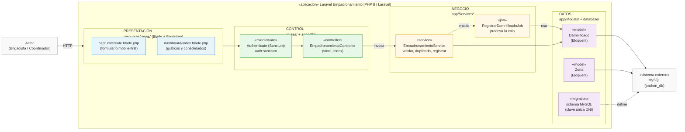

# Enfoque Arquitectónico: MVC en Capas con Servicios

## 1. Justificación del Enfoque

Para el **Sistema Transaccional de Empadronamiento**, se ha adoptado el enfoque de **MVC con una capa intermedia de servicios** dentro del framework Laravel. El patrón MVC tradicional de Laravel delegaría la lógica de negocio en los controllers; aquí se incorpora explícitamente una capa de *services* para mantener el corazón del sistema (reglas del padrón) independiente de HTTP.

| Elemento | Descripción aplicada al Sistema de Empadronamiento |
| :--- | :--- |
| **Patrón / Enfoque** | MVC (Model-View-Controller) con capa de servicios intermedia. |
| **Objetivo** que apunten siempre hacia las reglas de negocio (services y models), y nunca al revés. |
| **¿Qué problema resuelve?** | Evita el acoplamiento fuerte entre las reglas del padrón y los detalles técnicos (HTTP, Blade, MySQL, cola de mensajes). Si mañana la cola de Laravel cambia de driver `database` a `redis`, o el dashboard se consuma vía API, el negocio no se altera. |
| **Capas definidas** | Presentación (Blade), Control (Rutas, Middlewares, Controllers), Negocio (Services) y Datos (Models/Eloquent + MySQL). |
| **Beneficios** | Código testeable (los services se prueban sin HTTP), mantenible y modular, ideal para el escenario de alta concurrencia (3,000 usuarios). |

---

## 2. Diagrama de Capas (Módulo Empadronamiento)

---

## 3. Reglas de Dependencia

1. Las vistas (Blade) solo muestran datos que les envía un controller; no contienen reglas de negocio.
2. Los *controllers* solo reciben la petición, validan lo básico y delegan en un *service*: no acceden directamente a Eloquent ni a la cola.
3. Los *services* no conocen HTTP ni Blade: reciben arrays/objetos de dominio, aplican reglas y devuelven resultados (lo que permite reutilizarlos desde jobs, consola o API).
4. Los *models* (Eloquent) son la única puerta a MySQL, junto con las *migrations* que definen el esquema.
5. El registro masivo cruza la capa de negocio y la de datos mediante *jobs* de Laravel Queues, respetando la inversión de responsabilidades entre la recepción y la persistencia.
