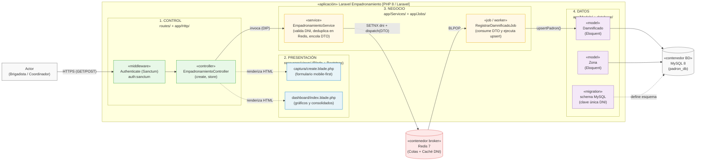

# Enfoque Arquitectónico: MVC en Capas con Servicios

## 1. Justificación del Enfoque

Para el **Sistema Transaccional de Empadronamiento**, se ha adoptado el enfoque de **MVC con una capa intermedia de servicios** dentro del framework Laravel, complementado con **procesamiento asíncrono sobre Redis**. Mientras que el patrón MVC tradicional suele acoplar las reglas de negocio a los controladores o modelos, la capa explícita de *services* mantiene las reglas del padrón independientes del transporte HTTP.

| Elemento | Descripción aplicada al Sistema de Empadronamiento |
| :--- | :--- |
| **Patrón / Enfoque** | MVC (Model-View-Controller) con capa de servicios intermedia y cola asíncrona (*Productor-Consumidor*). |
| **Objetivo** | Lograr que las dependencias apunten siempre hacia las reglas de negocio (*services* y contratos), desacoplando la recepción HTTP de la escritura en base de datos. |
| **¿Qué problema resuelve?** | Evita el acoplamiento entre las reglas del padrón y los detalles técnicos (HTTP, Blade, MySQL, Redis) y elimina el bloqueo de MySQL durante ráfagas de 3,000 brigadistas concurrentes (`DA01`, `DA06`). |
| **Capas definidas** | Presentación (Blade + Bootstrap), Control (Rutas, Middlewares, Controllers), Negocio (Services + Jobs) y Datos (Models/Eloquent + MySQL), apoyadas por Redis como broker de colas y caché. |
| **Beneficios** | Código testeable mediante interfaces (principio DIP), respuestas HTTP `< 2 s` al encolar en memoria y cero duplicados mediante validación en Redis + restricción `UNIQUE` en MySQL. |

---

## 2. Diagrama de Capas (Módulo Empadronamiento)

---

## 3. Reglas de Dependencia

1. **Flujo HTTP y Presentación:** Las peticiones HTTP entran siempre por la capa de **Control** (`Rutas` → `Middleware auth:sanctum` → `Controllers`). Los controladores invocan a los *services* y finalmente renderizan las vistas **Blade**; las vistas jamás contienen lógica de negocio ni consultas SQL.
2. **Controladores Delgados:** Los *controllers* validan el formato de la petición (`FormRequest`) y delegan en la interfaz del *service* (`EmpadronamientoServiceInterface`): no acceden directamente a Eloquent, Redis ni la cola.
3. **Servicios Independientes de HTTP:** Los *services* reciben estructuras de datos tipadas/arreglos, validan las reglas de dominio, reservan el DNI atómicamente en **Redis** y despachan el trabajo a la cola sin bloquear MySQL.
4. **Flujo Unidireccional en Jobs:** `RegistrarDamnificadoJob` recibe un DTO serializable (`array $datos`) desde Redis y persiste mediante el modelo Eloquent `Damnificado` (`upsert`), sin volver a llamar a `EmpadronamientoService`.
5. **Integridad en Capa de Datos:** Los *models* (Eloquent) y las *migrations* son la única puerta hacia **MySQL**, resguardando la clave única `UNIQUE (dni)` como garantía física final.
