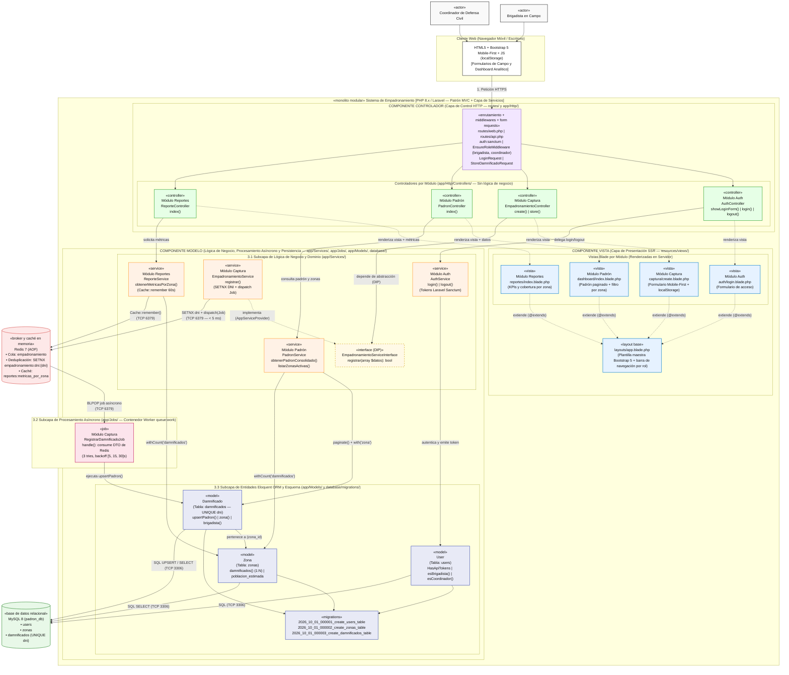

# Patrón Arquitectónico

## 1. Definición del Patrón Arquitectónico Global

Para el **Sistema Transaccional de Respuesta Rápida para el Empadronamiento**, se ha seleccionado e implementado el patrón arquitectónico **Modelo-Vista-Controlador (MVC) con Capa de Servicios** dentro de un **Monolito Modular**, operando bajo un esquema **Cliente-Servidor** con renderizado en servidor (SSR) y **procesamiento asíncrono desacoplado mediante Redis**.

* **Cliente-Servidor con Balanceo:** Separa el cliente web (vistas HTML5/Bootstrap 5 con respaldo en `localStorage` para microcortes en campo) del clúster de contenedores de servidor presidido por **Nginx**.
* **Monolito Modular:** Todas las funcionalidades residen en un mismo repositorio y base de código Laravel, particionado internamente en cuatro módulos de negocio cohesivos: **1. Autenticación (`Auth`)**, **2. Captura/Empadronamiento**, **3. Padrón** y **4. Reportes**.
* **Separación Estricta MVC (`ADR-002`, `ADR-003`):**
  * **Componente Controlador (`routes/`, `app/Http/`):** Enrutamiento HTTP (`web.php`, `api.php`), middlewares transversales (`auth:sanctum`, `EnsureRoleMiddleware`), validación de entrada (`LoginRequest`, `StoreDamnificadoRequest`) y controladores delgados (`AuthController`, `EmpadronamientoController`, `PadronController`, `ReporteController`).
  * **Componente Vista (`resources/views/`):** Plantilla maestra (`layouts/app.blade.php`) y vistas Blade por módulo (`auth/login.blade.php`, `captura/create.blade.php`, `dashboard/index.blade.php`, `reportes/index.blade.php`).
  * **Componente Modelo (`app/Services/`, `app/Jobs/`, `app/Models/`, `database/migrations/`):** Subcapa de lógica de negocio e inversión de dependencias (`EmpadronamientoServiceInterface`, `AuthService`, `EmpadronamientoService`, `PadronService`, `ReporteService`), procesamiento asíncrono en cola (`RegistrarDamnificadoJob`) y persistencia Eloquent (`User`, `Damnificado`, `Zona`) sobre **MySQL 8** y **Redis 7**.

## 2. Diagrama de la Arquitectura (Vista Estructural MVC)

## 3. Topología de Despliegue en Contenedores

Aunque el código fuente se mantiene en un solo repositorio monolítico Laravel (`ADR-001`), el despliegue en producción (`DA04`, `AC04`) separa responsabilidades en contenedores especializados para evitar puntos únicos de fallo:

* **Contenedor Balanceador (`Nginx`):** Recibe el tráfico HTTPS de los brigadistas y coordinadores y lo distribuye entre las réplicas web.
* **Contenedores Web (`xN` réplicas stateless de `App Web Laravel`):** Atienden las peticiones HTTP, validan tokens Sanctum y encolan los registros en Redis en `< 5 ms`.
* **Contenedor Broker y Caché (`Redis 7` con persistencia `AOF`):** Almacena la cola de trabajos sin pérdida ante reinicios, resuelve la deduplicación rápida de DNI (`SETNX`) y cachea los reportes por zona.
* **Contenedores Worker (`xM` procesos `php artisan queue:work`):** Consumen `RegistrarDamnificadoJob` desde Redis a ritmo controlado e insertan el padrón en MySQL sin saturar sus conexiones.
* **Contenedor / Servicio de Base de Datos (`MySQL 8 - padron_db`):** Resguarda de forma persistente e íntegra las tablas `users`, `zonas`, `damnificados` (`UNIQUE dni`) y `failed_jobs`.
