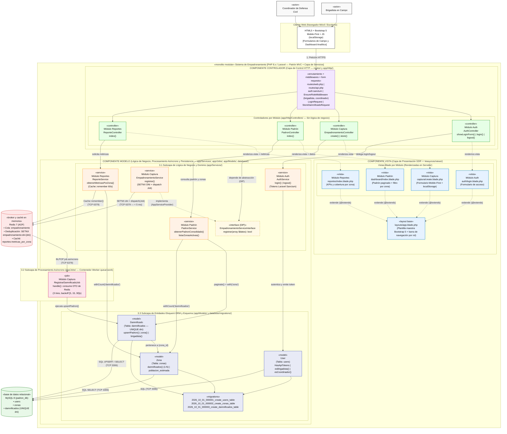

# Patrón y Estilos Arquitectónicos

## 1. Taxonomía de Estilos y Patrón Arquitectónico Aplicado

En la ingeniería de sistemas transaccionales modernos, una arquitectura robusta combina de forma jerárquica **estilos arquitectónicos macro** (nivel de topología y particionamiento) con un **patrón arquitectónico de aplicación** (nivel de organización del código fuente).

Para el **Sistema Transaccional de Respuesta Rápida para el Empadronamiento**, la arquitectura se define mediante la convergencia de cuatro niveles estructurales:

| Nivel Arquitectónico | Estilo / Patrón Seleccionado | Decisión / Driver | Rol Estructural en el Sistema |
| :--- | :--- | :--- | :--- |
| **1. Estilo de Red (Distribución)** | **Cliente-Servidor (*Client-Server*)** | `DA02`, `RC01` | Separa el cliente web ligero (navegador móvil/escritorio con HTML5, Bootstrap 5 y respaldo `localStorage`) del clúster de servidores Laravel presidido por **Nginx**. |
| **2. Estilo de Despliegue y Particionamiento** | **Monolito Modular (*Modular Monolith*)** | `ADR-001`, `DA04` | Empaqueta toda la base de código en una unidad cohesiva particionada en **4 módulos funcionales** (`Auth`, `Captura/Empadronamiento`, `Padrón` y `Reportes`), desplegada en contenedores especializados (`App Web` + `Workers`). |
| **3. Patrón Arquitectónico Interno (Código)** | **Modelo-Vista-Controlador (MVC) en Capas con Servicios** | `ADR-002`, `DA06` | Divide cada módulo en **Controlador** (`routes/`, `app/Http/`), **Vista** (`resources/views/`) y **Modelo** subdividido en **Lógica de Negocio** (`app/Services/`), **Cola Asíncrona** (`app/Jobs/`) y **Persistencia** (`app/Models/`, `database/`). |
| **4. Estilo de Concurrencia e Integración** | **Productor-Consumidor Basado en Colas (*Queue-Centric*)** | `ADR-003`, `DA01` | Desacopla la recepción HTTP masiva (productor `EmpadronamientoService`) de la inserción relacional en MySQL (consumidor `RegistrarDamnificadoJob` en procesos `queue:work`) a través de **Redis 7 (AOF)**. |

---

## 2. Diagrama de la Arquitectura (Vista Estructural MVC)

---

## 3. Matriz de Separación y Reglas del Patrón MVC

Para garantizar el atributo de **Mantenibilidad (`AC06`, `DA06`)**, cada componente del patrón MVC cumple reglas estrictas de responsabilidad y acoplamiento:

| Componente MVC | Ubicación en el Repositorio | Artefactos Implementados | Dependencias Permitidas | Dependencias Prohibidas |
| :--- | :--- | :--- | :--- | :--- |
| **CONTROLADOR (`C`)** *(Capa de Control HTTP)* | `routes/` `app/Http/Controllers/` `app/Http/Middleware/` `app/Http/Requests/` | • `web.php`, `api.php` • `EnsureRoleMiddleware` • `LoginRequest`, `StoreDamnificadoRequest` • `AuthController`, `EmpadronamientoController`, `PadronController`, `ReporteController` | • `EmpadronamientoServiceInterface` (en módulo Captura) • `AuthService`, `PadronService`, `ReporteService` • Vistas Blade (`view(...)`) | ❌ Consultas directas a Eloquent (`User`, `Damnificado`, `Zona`) ❌ Llamadas directas a `Redis` o despacho directo de `Jobs` ❌ Cálculos estadísticos o reglas de negocio |
| **VISTA (`V`)** *(Capa de Presentación SSR)* | `resources/views/` | • `layouts/app.blade.php` • `auth/login.blade.php` • `captura/create.blade.php` • `dashboard/index.blade.php` • `reportes/index.blade.php` | • Variables/DTOs inyectados por el Controlador • Plantilla maestra (`@extends('layouts.app')`) • API `localStorage` del navegador | ❌ Invocar `Services` o `Models` desde directivas `@php` ❌ Ejecutar consultas SQL o lógica de validación de dominio |
| **MODELO (`M` — Negocio)** *(Subcapa de Servicios)* | `app/Services/` `app/Providers/` | • `EmpadronamientoServiceInterface` • `AuthService`, `EmpadronamientoService`, `PadronService`, `ReporteService` • `AppServiceProvider` | • Modelos Eloquent (`User`, `Damnificado`, `Zona`) • `Redis` (`SETNX`, `Cache::remember`) • Despacho de `RegistrarDamnificadoJob` | ❌ Objetos HTTP (`Request`, `RedirectResponse`, `Session`) ❌ Renderizado de vistas Blade |
| **MODELO (`M` — Cola)** *(Subcapa Asíncrona)* | `app/Jobs/` | • `RegistrarDamnificadoJob` | • Modelo `Damnificado::upsertPadron()` • `Redis::del()` (en `failed()` para liberar DNI) | ❌ `EmpadronamientoService` (evita ciclos de dependencia) ❌ Capa HTTP o Vistas |
| **MODELO (`M` — Datos)** *(Subcapa de Persistencia)* | `app/Models/` `database/migrations/` | • `User`, `Damnificado`, `Zona` • 3 migraciones relacionales (`users`, `zonas`, `damnificados`) | • Motor relacional **MySQL 8 (`padron_db`)** y traits de Eloquent/Sanctum | ❌ `Controllers`, `Services`, `Jobs` o `Vistas` |

---

## 4. Evaluación Comparativa frente a Alternativas Descartadas

La elección del **Monolito Modular en Capas (MVC + Services + Queues)** se justifica al contrastarla con otras alternativas arquitectónicas evaluadas para el proyecto:

| Alternativa Evaluada | Ventajas | Por qué fue descartada / seleccionada frente a los Drivers (`DA01`–`DA06`) | Decisión |
| :--- | :--- | :--- | :--- |
| **A. Monolito Modular MVC + Capa de Servicios + Colas en Redis** *(Arquitectura Elegida)* | • Respuesta `< 2 s` ante 3,000 brigadistas gracias a Redis (`DA01`). • Reglas de negocio aisladas y testeables (`DA06`). • Despliegue simple en contenedores sin latencia de red entre módulos (`DA04`). | Cumple el 100% de las restricciones (`RC01`–`RC06`) y atributos de calidad (`AC01`–`AC06`) con la menor complejidad accidental. | ✅ **SELECCIONADA** (`ADR-001`, `ADR-002`, `ADR-003`) |
| **B. MVC Tradicional sin Capa de Servicios** *(Lógica en Controllers o Models)* | • Menor cantidad inicial de archivos en proyectos pequeños. | Genera *Fat Controllers* acoplados a HTTP y a Eloquent, incumpliendo `DA06` (`AC06` - Mantenibilidad) y dificultando la deduplicación previa en Redis y el testeo unitario con mocks. | ❌ **DESCARTADA** |
| **C. Monolito con Escritura Síncrona Directa en MySQL** *(Sin Redis / Queues)* | • No requiere contenedor Redis ni procesos `queue:work`. | Ante un pico simultáneo de 3,000 brigadistas (`DA01`), las transacciones concurrentes de `INSERT` agotarían el pool de conexiones de MySQL (`max_connections`), causando errores HTTP `500/504` y pérdida de registros en campo. | ❌ **DESCARTADA** |
| **D. Arquitectura de Microservicios** *(Servicios separados para Auth, Captura, Padrón y Reportes)* | • Escalado independiente extremo por dominio en organizaciones grandes. | Introduce sobrecosto operativo (múltiples bases de datos, consistencia eventual entre servicios, API Gateway complejo) injustificado para un dominio cohesivo de 4 módulos que ya escala horizontalmente separando contenedores `Web` y `Workers`. | ❌ **DESCARTADA** |

---

## 5. Topología de Despliegue en Contenedores

Aunque el código fuente se mantiene en un solo repositorio monolítico Laravel (`ADR-001`), el despliegue en producción (`DA04`, `AC04`) separa responsabilidades en contenedores especializados para evitar puntos únicos de fallo:

* **Contenedor Balanceador (`Nginx`):** Recibe el tráfico HTTPS de los brigadistas y coordinadores y lo distribuye entre las réplicas web.
* **Contenedores Web (`xN` réplicas stateless de `App Web Laravel`):** Atienden las peticiones HTTP, validan tokens Sanctum y encolan los registros en Redis en `< 5 ms`.
* **Contenedor Broker y Caché (`Redis 7` con persistencia `AOF`):** Almacena la cola de trabajos sin pérdida ante reinicios, resuelve la deduplicación rápida de DNI (`SETNX`) y cachea los reportes por zona.
* **Contenedores Worker (`xM` procesos `php artisan queue:work`):** Consumen `RegistrarDamnificadoJob` desde Redis a ritmo controlado e insertan el padrón en MySQL sin saturar sus conexiones.
* **Contenedor / Servicio de Base de Datos (`MySQL 8 - padron_db`):** Resguarda de forma persistente e íntegra las tablas `users`, `zonas`, `damnificados` (`UNIQUE dni`) y `failed_jobs`.
