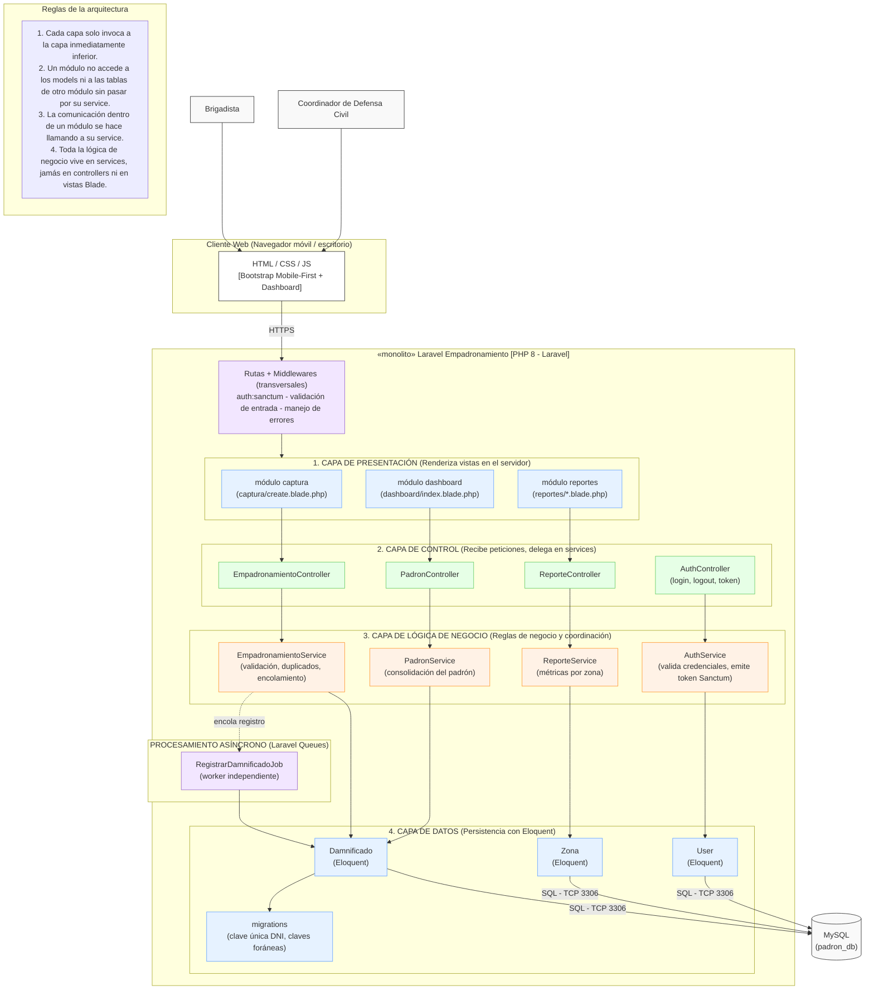

# Estilo Arquitectónico

## 1. Definición del Estilo Global

Para el Sistema Transaccional de Respuesta Rápida para el Empadronamiento, se ha seleccionado un estilo arquitectónico de **Monolito Modular organizado en Capas (MVC con servicios)**, operando bajo un modelo **Cliente-Servidor** y con presentación en servidor.

*   **Cliente-Servidor:** Separa claramente la interfaz de usuario (vistas Blade servidas por HTTP) del procesamiento centralizado (Laravel + MySQL).
*   **Monolito Modular:** Todas las funcionalidades se despliegan como una sola unidad (la aplicación Laravel), pero internamente el código está dividido por módulos de negocio (Auth, Captura/Empadronamiento, Padrón y Reportes).
*   **Arquitectura en Capas (MVC + servicios):** Dentro del monolito, las responsabilidades se dividen en Presentación (Blade), Control (Rutas, Middlewares, Controllers), Lógica de Negocio (Services y Jobs) y Datos (Models/Eloquent + MySQL).

## 2. Diagrama de la Arquitectura (Vista Estructural)

## 3. Despliegue

Aunque el código forma un solo monolito Laravel, el despliegue en contenedores separa al menos dos procesos:

* **Contenedor web:** atiende las peticiones HTTP (rutas, controllers, vistas Blade).
* **Contenedor worker:** ejecuta `php artisan queue:work` para procesar los jobs de registro masivo.
* **MySQL:** motor relacional externo (contenedor o servicio gestionado), comunicado por TCP 3306.
