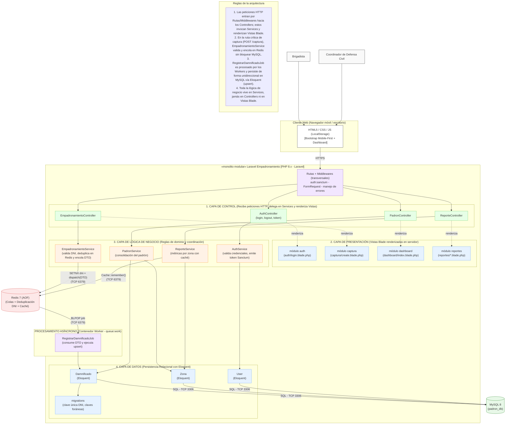

# Estilo Arquitectónico

## 1. Definición del Estilo Global

Para el **Sistema Transaccional de Respuesta Rápida para el Empadronamiento**, se ha seleccionado un estilo arquitectónico de **Monolito Modular organizado en Capas (MVC con Capa de Servicios)**, operando bajo un modelo **Cliente-Servidor** con renderizado en servidor y **procesamiento asíncrono desacoplado mediante Redis**.

* **Cliente-Servidor con Balanceo:** Separa el cliente web (vistas HTML5/Bootstrap con respaldo en `localStorage` para microcortes en campo) del clúster de contenedores de servidor presidido por **Nginx**.
* **Monolito Modular:** Todas las funcionalidades residen en un mismo repositorio y base de código Laravel, particionado internamente en cuatro módulos de negocio cohesivos: **Autenticación (`Auth`)**, **Captura/Empadronamiento**, **Padrón** y **Reportes**.
* **Arquitectura en Capas (MVC + Services + Queues):** Las responsabilidades se dividen estrictamente en **Control** (Rutas, Middlewares, Controllers), **Presentación** (Vistas Blade renderizadas por los Controllers), **Lógica de Negocio** (Services y Jobs) y **Datos** (Models Eloquent + Migrations sobre MySQL), utilizando **Redis** como broker en memoria para absorber picos de 3,000 brigadistas concurrentes.

## 2. Diagrama de la Arquitectura (Vista Estructural)

## 3. Topología de Despliegue en Contenedores

Aunque el código fuente se mantiene en un solo repositorio monolítico Laravel (`ADR-001`), el despliegue en producción (`DA04`, `AC04`) separa responsabilidades en contenedores especializados para evitar puntos únicos de fallo:

* **Contenedor Balanceador (`Nginx`):** Recibe el tráfico HTTPS de los brigadistas y coordinadores y lo distribuye entre las réplicas web.
* **Contenedores Web (`xN` réplicas stateless de `App Web Laravel`):** Atienden las peticiones HTTP, validan tokens Sanctum y encolan los registros en Redis en `< 5 ms`.
* **Contenedor Broker y Caché (`Redis 7` con persistencia `AOF`):** Almacena la cola de trabajos sin pérdida ante reinicios, resuelve la deduplicación rápida de DNI (`SETNX`) y cachea los reportes por zona.
* **Contenedores Worker (`xM` procesos `php artisan queue:work`):** Consumen `RegistrarDamnificadoJob` desde Redis a ritmo controlado e insertan el padrón en MySQL sin saturar sus conexiones.
* **Contenedor / Servicio de Base de Datos (`MySQL 8 - padron_db`):** Resguarda de forma persistente e íntegra las tablas `users`, `zonas`, `damnificados` (`UNIQUE dni`) y `failed_jobs`.
