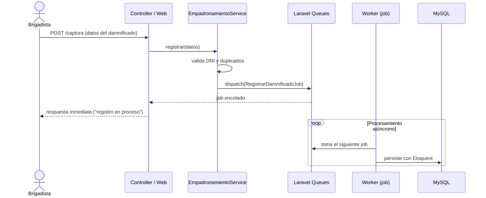

# Patrones de Diseño Aplicados

Patrones utilizados en la implementación del sistema, el problema que resuelven y dónde viven en el código Laravel.

| Patrón | Tipo | Problema que resuelve | Dónde se aplica |
|---|---|---|---|
| **MVC con capa de servicios** | Arquitectónico | Mantener la lógica de negocio separada del detalle HTTP y de la persistencia. | Controllers → `app/Services/*` → Models (Eloquent). |
| **Façade (Fachada)** | Estructural | Ofrecer una interfaz simple y estable sobre un subsistema complejo (colas, caché, ORM). | Los *services* actúan como fachada del módulo; además Laravel expone sus propias fachadas (`Queue`, `DB`, `Hash`). |
| **Repository (repositorio)** | Estructural | Desacoplar el negocio de la fuente de datos concreta. | Las consultas del padrón se concentran en el `PadronService`/scopes de Eloquent, evitando SQL disperso en controllers. |
| **Observer** | Estructural | Reaccionar a eventos del dominio sin acoplar emisor y receptor. | Observadores de Eloquent sobre `Damnificado` (p. ej. notificar o sincronizar al crear un registro). |
| **Producer-Consumer (Productor-Consumidor)** | De comportamiento | Absorber picos de 3,000 registros concurrentes sin saturar MySQL. | `EmpadronamientoService` (productor) → Laravel Queues → `RegistrarDamnificadoJob` (consumidor en el worker). |
| **Chain of Responsibility (Middleware)** | De comportamiento | Validar autenticación, permisos y formato de entrada de forma modular y reutilizable. | Middlewares `auth:sanctum`, validación de entrada y manejo de errores en `app/Http/Middleware/`. |
| **Singleton (Container)** | Creacional | Centralizar la instancia de la aplicación y de los servicios inyectados. | Contenedor de dependencias de Laravel: los services se resuelven e inyectan vía *constructor injection*. |

## Ejemplo: Productor-Consumer en el registro masivo

## Criterio de selección

Los patrones elegidos son deliberadamente sobrios: el sistema es un monolito Laravel y no requiere patrones de Clean Architecture (puertos y adaptadores) para cumplir sus requisitos. Cada patrón aplicado resuelve un problema concreto documentado en los drivers arquitectónicos (DA01 a DA06).
