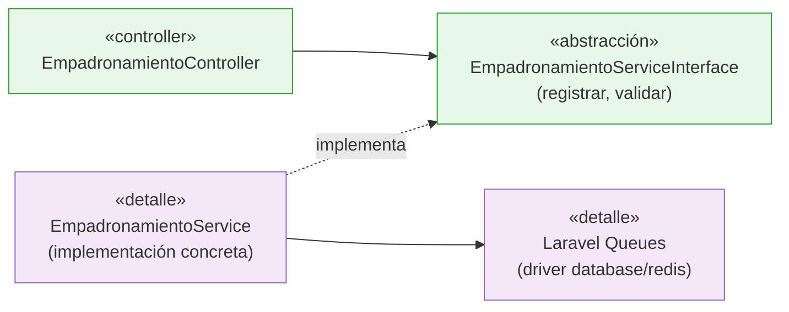

# Principios de Diseño Aplicados

Aplicación de los principios SOLID al código Laravel del sistema, con un ejemplo concreto de cada uno.

| Principio | Aplicación en el sistema |
|---|---|
| **SRP - Responsabilidad Única** | Cada clase tiene un solo motivo de cambio: el *controller* solo orquesta la petición, el *service* solo aplica reglas de negocio, el *model* solo representa datos y el *job* solo orquesta el registro encolado. |
| **OCP - Abierto/Cerrado** | Para agregar una nueva zona de validación o un tipo de daño, se agregan reglas o categorías nuevas sin modificar los services existentes; las reglas parametrizables viven en configuración/modelos. |
| **LSP - Sustitución de Barbajanes** | Cualquier implementación que cumpla el contrato de un service puede sustituir a la original (p. ej. un `ReporteService` de prueba en tests) sin romper al controller que lo consume. |
| **ISP - Segregación de Interfaces** | Se inyectan solo los métodos necesarios (p. ej. un repository/expuesto de solo lectura para el dashboard, frente al service completo de escritura). |
| **DIP - Inversión de Dependencias** | Los controllers y jobs dependen de las abstracciones (services) y no de detalles concretos de Eloquent o de la cola: el detalle (MySQL, driver de la cola) es sustituible sin tocar la lógica de negocio. |

## Ejemplo: DIP en el registro de damnificados

El controller no sabe si el registro se guarda de forma síncrona o se encola en Redis: solo conoce el contrato del service. Ese es el beneficio concreto del principio en este proyecto.

## Relación con los atributos de calidad

* **AC06 Mantenibilidad:** los principios SRP y DIP son su soporte directo.
* **AC03 Integridad de datos:** el OCP permite agregar reglas de validación sin tocar el flujo de registro ya probado.
