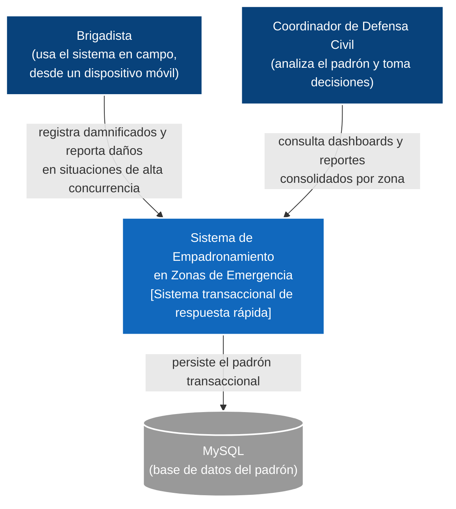

# Nivel 1 - Diagrama de Contexto del Sistema

Vista más alta: el sistema y su interacción con los actores humanos y los sistemas externos.

## Descripción

| Elemento | Tipo | Descripción |
|---|---|---|
| Brigadista | Actor humano | Registra datos demográficos y daños materiales desde campo, con conectividad inestable. |
| Coordinador de Defensa Civil | Actor humano | Consulta el padrón consolidado y los reportes de cobertura por zona. |
| Sistema de Empadronamiento | Sistema | Aplicación web Laravel que captura, valida, encola y consolida el padrón. |
| MySQL | Sistema externo | Motor relacional donde persiste el padrón único de damnificados. |
