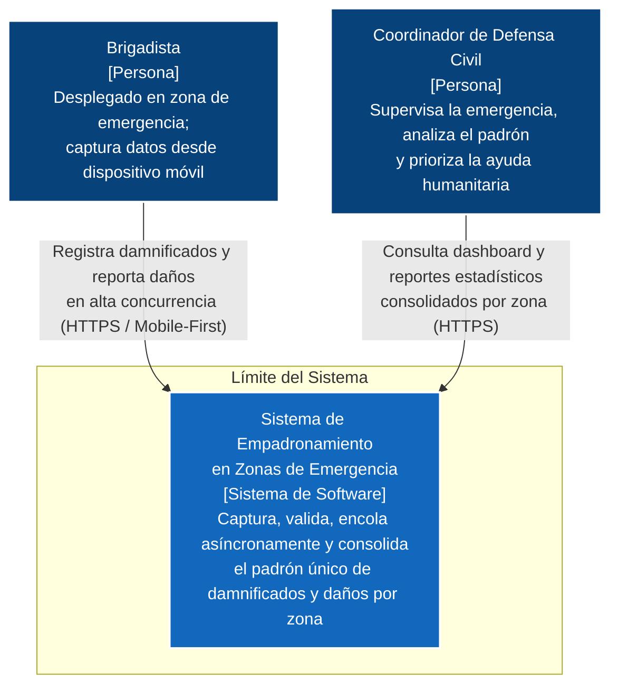

# Nivel 1 - Diagrama de Contexto del Sistema

Vista de más alto nivel del **Modelo C4**: delimita la frontera del **Sistema de Empadronamiento en Zonas de Emergencia** y muestra su interacción con los actores humanos que operan en campo y en el centro de operaciones.

> [!NOTE]
> **Consistencia de fronteras C4:** Los motores propios de persistencia (**MySQL**) y de mensajería/caché (**Redis**) forman parte de la infraestructura interna del sistema y se descomponen en el **Nivel 2 (Diagrama de Contenedores)**, manteniendo limpia la vista de contexto.

## Elementos del Contexto

| Elemento | Tipo C4 | Rol e Interacción con el Sistema |
| :--- | :--- | :--- |
| **Brigadista** | Persona (Actor humano) | Registra datos demográficos (DNI, nombres, apellidos) y daños materiales desde el campo bajo condiciones de conectividad inestable y picos de hasta 3,000 usuarios concurrentes (`DA01`, `AC01`). |
| **Coordinador de Defensa Civil** | Persona (Actor humano) | Consulta el padrón consolidado y los reportes estadísticos de cobertura por zona afectada para la toma de decisiones logísticas (`RF05`, `RF06`). |
| **Sistema de Empadronamiento en Zonas de Emergencia** | Sistema de Software | Plataforma transaccional de respuesta rápida (Monolito Modular Laravel desplegado en contenedores con colas Redis y persistencia MySQL) que garantiza recepción sin bloqueos e integridad del padrón (`AC03`, `AC04`). |
