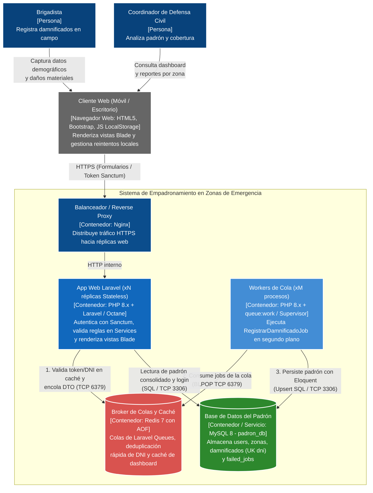

# Nivel 2 - Diagrama de Contenedores

Descomposición del **Sistema de Empadronamiento en Zonas de Emergencia** en unidades desplegables y de ejecución independientes (contenedores), diseñada para absorber picos de **3,000 brigadistas concurrentes** sin puntos únicos de fallo en la capa web ni bloqueos en la base de datos relacional.

## Inventario de Contenedores

| Contenedor | Tecnología | Responsabilidad Arquitectónica |
| :--- | :--- | :--- |
| **Cliente Web (Móvil / Escritorio)** | HTML5, Bootstrap (Mobile-First), JS (`localStorage`) | Ejecuta la interfaz en el navegador del actor; retiene temporalmente el formulario en almacenamiento local ante microcortes de red en campo (`RC07`). |
| **Balanceador / Reverse Proxy** | Nginx (Contenedor) | Termina conexiones HTTPS y reparte la carga entre las $N$ réplicas stateless de la aplicación web para evitar un punto único de fallo (`AC04`). |
| **App Web Laravel (`xN` réplicas)** | PHP 8.x + Laravel / Octane | Atiende peticiones HTTP, valida tokens de **Laravel Sanctum**, verifica duplicados en memoria y despacha DTOs a la cola sin bloquear MySQL (`DA01`, `ADR-002`). |
| **Broker de Colas y Caché** | Redis 7 (con persistencia `AOF`) | Actúa como intermediario del patrón *Productor-Consumidor* para **Laravel Queues**, realiza deduplicación atómica de DNI (`SETNX`) en `< 1 ms` y cachea tokens y métricas del dashboard (`ADR-003`). |
| **Workers de Cola (`xM` procesos)** | PHP 8.x + `php artisan queue:work` (Supervisor) | Consume asíncronamente `RegistrarDamnificadoJob` desde Redis y ejecuta la persistencia transaccional controlada hacia MySQL. |
| **Base de Datos del Padrón** | MySQL 8 (`padron_db`) | Fuente de verdad relacional del padrón consolidado (`users`, `zonas`, `damnificados` con restricción física `UNIQUE (dni)` y `failed_jobs`) (`DA03`, `AC03`). |

> [!IMPORTANT]
> **Desacoplamiento Productor-Consumidor:** La `App Web Laravel` nunca invoca directamente al `Worker de Cola` ni ejecuta escrituras pesadas en `MySQL` durante el `POST /captura`. Toda la comunicación asíncrona ocurre a través del contenedor **Redis**, garantizando tiempos de respuesta `< 2 s` bajo alta concurrencia.
