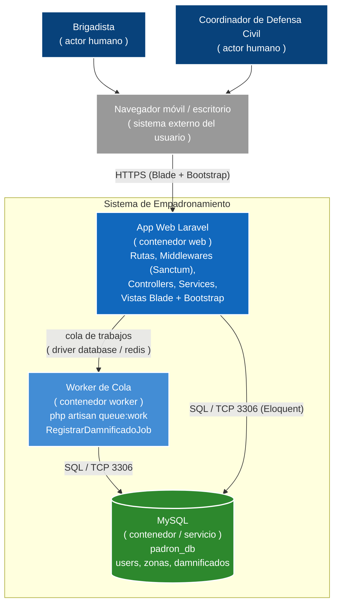

# Nivel 2 - Diagrama de Contenedores

Descomposición del sistema en unidades desplegables (contenedores): aplicación web Laravel, worker de la cola y base de datos.

## Contenedores

| Contenedor | Tecnología | Responsabilidad |
|---|---|---|
| App Web Laravel | PHP 8 + Laravel (Blade, Bootstrap) | Atiende HTTP, autentica con Sanctum, aplica reglas vía services y renderiza vistas. |
| Worker de Cola | Laravel Queues (`queue:work`) | Procesa los jobs de registro masivo de forma asíncrona. |
| MySQL | MySQL 8 | Persistencia relacional del padrón transaccional. |

> Nota: la comunicación entre la app y el worker se realiza a través de la cola (tabla de jobs o Redis), nunca mediante llamadas directas al proceso worker.
