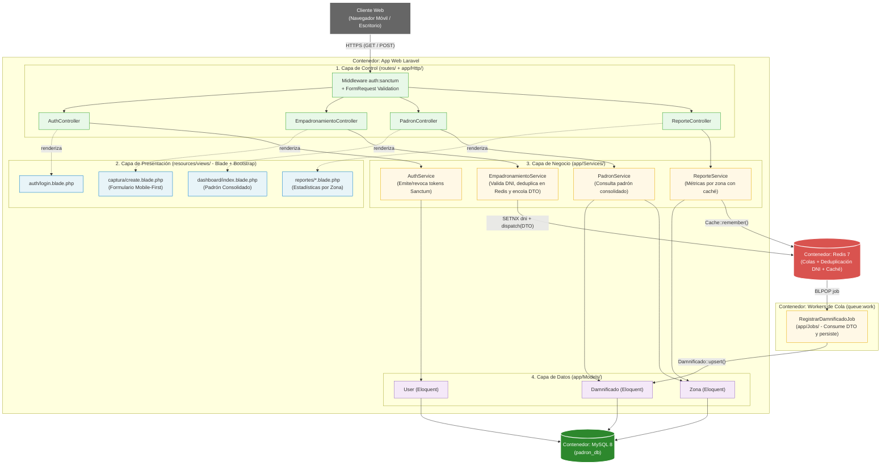

# Nivel 3 - Diagrama de Componentes

Vista interna del contenedor **App Web Laravel** y su relación con el contenedor **Workers de Cola**, **Redis** y **MySQL**, aplicando el patrón arquitectónico **MVC en Capas con Servicios** (`ADR-002`).

## Reglas de Dependencia entre Componentes

| Componente | Depende de | Prohibido depender de | Responsabilidad Clave |
| :--- | :--- | :--- | :--- |
| **Middlewares (`auth:sanctum`)** | Tokens Sanctum / Caché Redis | Services de dominio, Models de negocio | Interceptar peticiones HTTP, validar autenticación y formato de entrada antes del Controller. |
| **Controllers (`app/Http/Controllers`)** | Abstracciones de Services (`*ServiceInterface`), Vistas Blade | Eloquent (`Models`), `Redis`, `Jobs` directamente | Recibir la petición HTTP, delegar la acción al Service del módulo y devolver la vista Blade renderizada o respuesta HTTP `202`. |
| **Vistas Blade (`resources/views`)** | Datos (DTOs/ViewModels) inyectados por el Controller | Services, Models Eloquent, MySQL | Renderizar HTML5 + Bootstrap en el servidor sin ejecutar consultas ni reglas de negocio. |
| **Services (`app/Services`)** | `Redis` (caché/colas), `Jobs`, `Models` (en lecturas/login) | `Request`/`Response` HTTP, Vistas Blade | Encapsular la lógica de negocio: `EmpadronamientoService` valida el DNI, verifica duplicados atómicamente en Redis y encola `RegistrarDamnificadoJob`. |
| **Jobs (`app/Jobs`)** | Modelo `Damnificado` (Eloquent) | HTTP, Vistas Blade, `EmpadronamientoService` (evita ciclos) | Ejecutar en el contenedor `Worker` la inserción idempotente (`upsert`) del DTO encolado hacia MySQL. |
| **Models (`app/Models`)** | Motor relacional `MySQL` (`padron_db`) | Controllers, Services, Vistas | Mapear las tablas `users`, `zonas` y `damnificados` y sus restricciones de integridad. |
