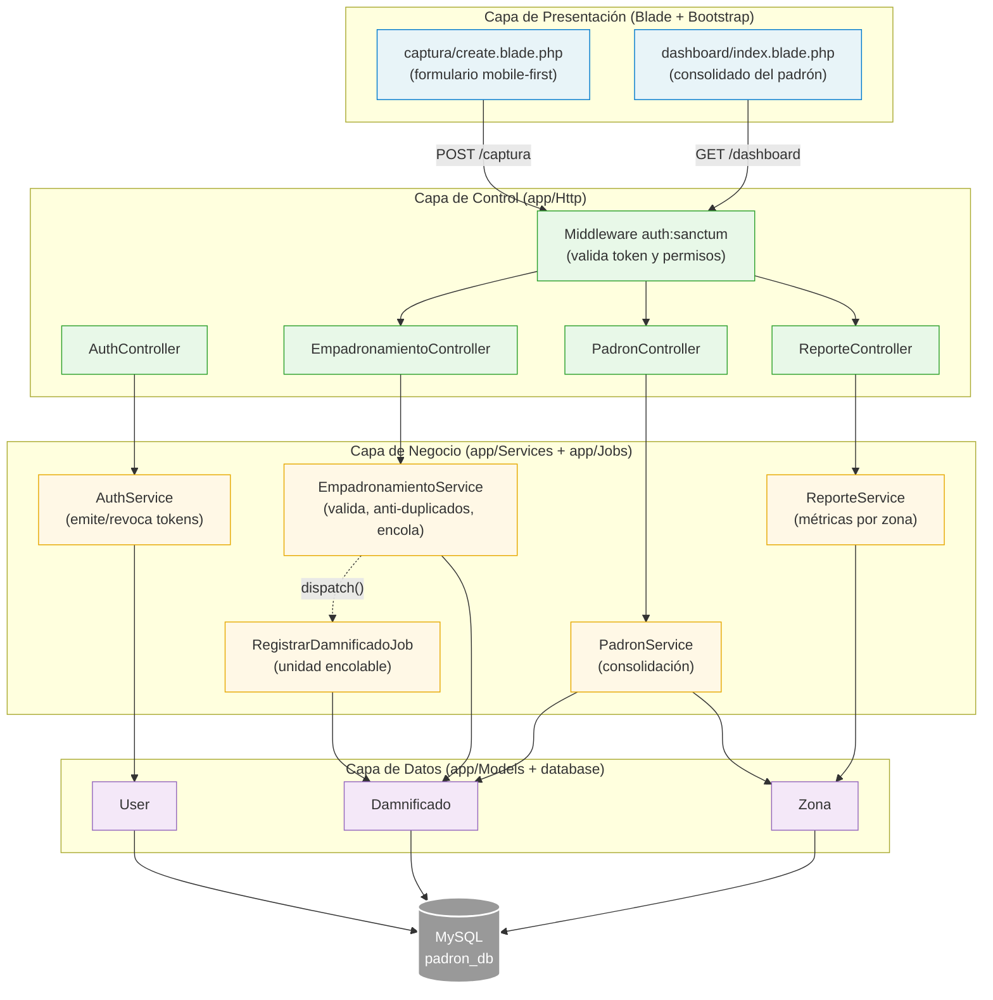

# Nivel 3 - Diagrama de Componentes

Internos del contenedor "App Web Laravel": los componentes de las capas MVC con servicios y su relación con el worker de la cola.

## Componentes y dependencias

| Componente | Depende de | No debe depender de |
|---|---|---|
| Vistas Blade | Controllers (datos enviados) | Models, MySQL |
| Middlewares | Tokens Sanctum | Services |
| Controllers | Services de su módulo | Eloquent directo, cola |
| Services | Models, Jobs | HTTP, vistas Blade |
| Jobs | Services/Models | HTTP, vistas Blade |
| Models | MySQL (Eloquent) | Controllers, Services |
