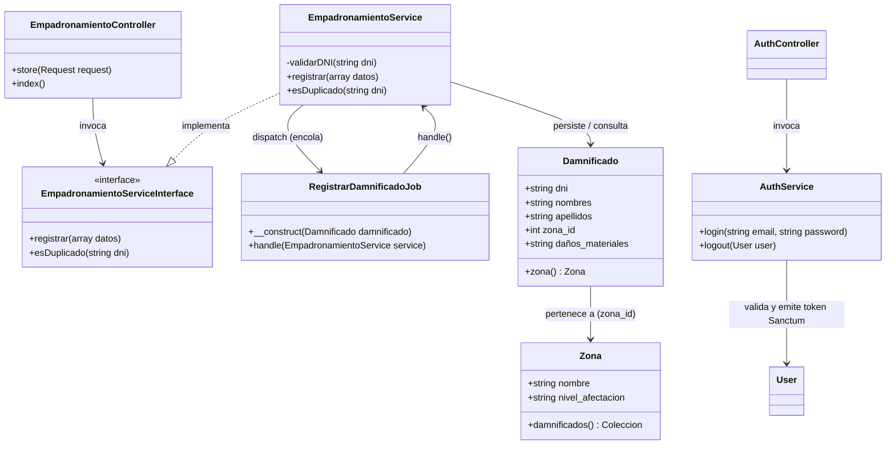

# Nivel 4 - Diagrama de Código

Detalle de las clases clave del módulo de Empadronamiento: sus atributos, métodos y relaciones (diagrama de clases UML).

## Notas de implementación

* `EmpadronamientoServiceInterface` existe para poder sustituir la implementación en pruebas (principio DIP), aunque el sistema es un monolito.
* `Damnificado.dni` tiene restricción **UNIQUE** definida en su migración: es la garantía física de la regla anti-duplicados (RF03).
* `RegistrarDamnificadoJob` implementa `ShouldQueue`; el worker ejecuta `handle()` fuera del ciclo de vida de la petición HTTP.
* La autenticación usa tokens de Laravel Sanctum asociados al modelo `User`.
