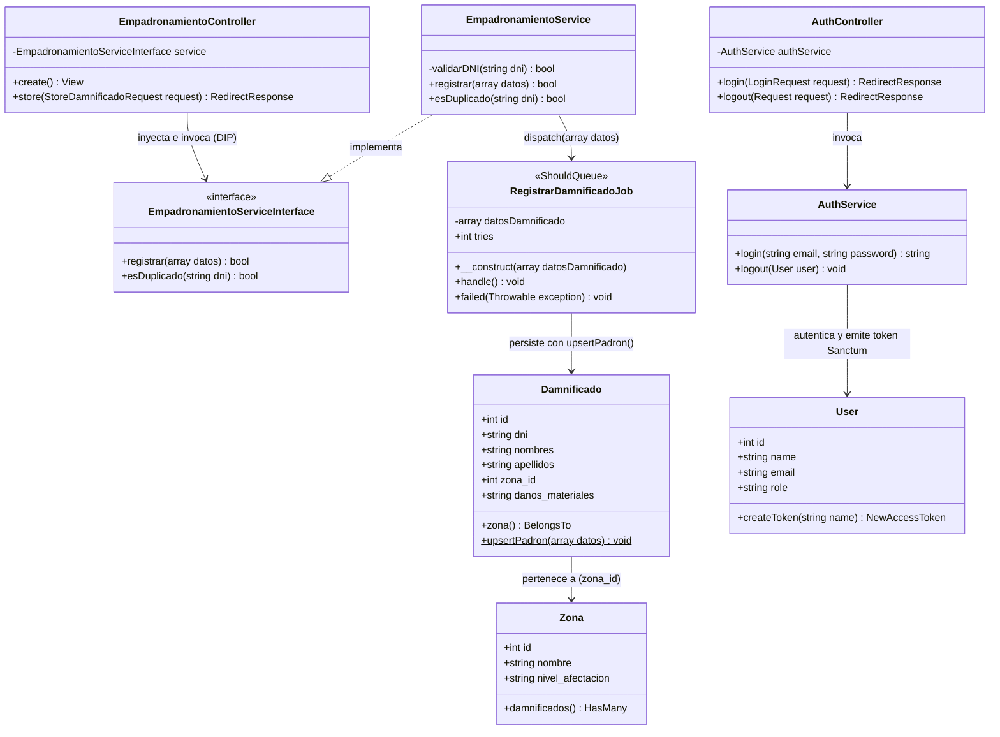

# Nivel 4 - Diagrama de Código

Detalle de clases UML de los módulos de **Empadronamiento** y **Autenticación**, mostrando la aplicación del **Principio de Inversión de Dependencias (DIP)** y un flujo unidireccional libre de dependencias circulares entre el servicio productor (`EmpadronamientoService`) y el consumidor asíncrono (`RegistrarDamnificadoJob`).

## Decisiones de Diseño a Nivel de Código

1. **Eliminación de Dependencia Circular (`Service → Job → Model`):**
   - `EmpadronamientoService::registrar(array $datos)` valida el formato del DNI, comprueba/reserva el DNI de forma atómica en **Redis** (`esDuplicado`) y despacha `RegistrarDamnificadoJob` pasando un **arreglo serializable (`array $datosDamnificado`)** en lugar de una instancia Eloquent aún no persistida.
   - `RegistrarDamnificadoJob::handle()` se ejecuta en el proceso *worker* y persiste directamente a través de `Damnificado::upsertPadron($this->datosDamnificado)`, sin volver a invocar a `EmpadronamientoService`.
2. **Inversión de Dependencias (DIP):**
   - `EmpadronamientoController` depende exclusivamente de la interfaz `EmpadronamientoServiceInterface`, lo que permite sustituir la implementación en pruebas unitarias sin levantar Redis ni MySQL.
3. **Garantía Doble Anti-Duplicados (`RF03` / `AC03`):**
   - **Primera barrera (en memoria):** `EmpadronamientoService::esDuplicado()` ejecuta `Redis::setnx("dni:{$dni}", 1)` en tiempo $O(1)$ durante la petición HTTP.
   - **Segunda barrera (física en BD):** La columna `damnificados.dni` posee restricción **`UNIQUE`** en MySQL y el job ejecuta una operación idempotente (`upsert`), garantizando **0 duplicados** incluso ante condiciones de carrera.
