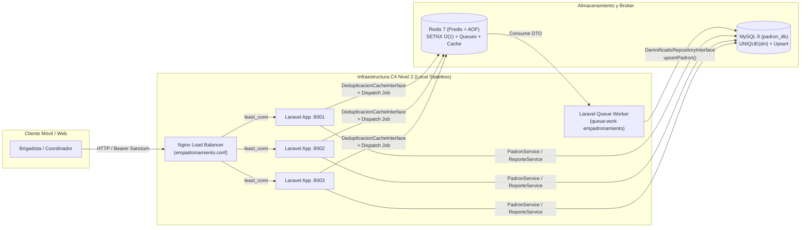
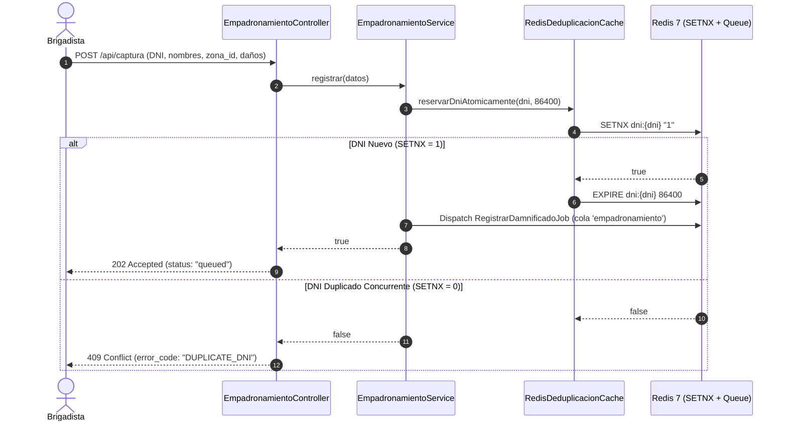

# Documento de Especificación de Diseño de Software (SDD) — Funcionalidades del Sprint 2

| Metadato | Detalle |
| :--- | :--- |
| **Proyecto** | Sistema Transaccional de Respuesta Rápida para el Empadronamiento en Zonas de Emergencia |
| **Sprint** | Sprint 2 — Implementación de Dominio, DIP/Repositories, Infraestructura Local C4 Nivel 2 y OpenAPI 3.0 |
| **Patrón Arquitectónico** | Monolito Modular en Capas (MVC + Capa de Servicios + Patrón Repository + Productor-Consumidor) |
| **Stack Técnico** | PHP 8.2+, Laravel 11, Laravel Sanctum, Redis 7 (`predis` + `AOF`), MySQL 8 (`InnoDB`), Nginx Reverse Proxy, L5-Swagger (OpenAPI 3.0) |
| **Trazabilidad Global** | `RF01`–`RF06`, `AC01`–`AC06`, `RC01`–`RC07`, `DA01`–`DA06`, `ADR-001`–`ADR-004` |

---

## 1. Resumen Arquitectónico del Sprint 2

En el **Sprint 2** se materializa el diseño arquitectónico definido en el Sprint 1 pasando de un modelo conceptual a una arquitectura ejecutable en **Laravel 11** que cumple estrictamente con:
1. **Principio de Inversión de Dependencias (DIP - SOLID) y Patrón Repository:** Los servicios de negocio (`app/Services/`) y consumidores asíncronos (`app/Jobs/`) dependen únicamente de contratos (`app/Repositories/Contracts/`), erradicando llamadas estáticas acopladas a `Damnificado::upsert` o `Redis::setnx`.
2. **Infraestructura Local de Alta Concurrencia (C4 Nivel 2 sin Docker):** Balanceador **Nginx** (`infra/nginx/empadronamiento.conf`) distribuyendo tráfico mediante `least_conn` hacia 3 instancias locales *stateless* (`127.0.0.1:8001..8003`) y broker **Redis 7** (`infra/redis/redis.conf`) con durabilidad `AOF` (`appendonly yes`, `appendfsync everysec`).
3. **Contratos REST Documentados con OpenAPI 3.0 (L5-Swagger):** Especificación central en `app/Http/OpenApi/OpenApiSpec.php` y anotaciones `@OA\*` en todos los controladores.

---

## 2. Especificación Detallada por Funcionalidad

---

### 2.1. Funcionalidad F01: Autenticación Basada en Tokens y Control de Acceso por Rol (RBAC)

- **IDs Trazables:** `RF01`, `HU01`, `HU03`, `AC05` (Seguridad), `DA05`, `ADR-004`.
- **Actores:** *Brigadista de Campo* (`brigadista`) y *Coordinador de Defensa Civil* (`coordinador`).

#### A. Objetivo
Autenticar a los actores del sistema mediante credenciales institucionales y emitir tokens **Bearer de Laravel Sanctum** con habilidades (*abilities*) diferenciadas según el rol, protegiendo las rutas de captura, padrón consolidado y reportes ante accesos no autorizados en redes móviles inestables.

#### B. Flujo Técnico
1. El cliente envía `POST /api/auth/token` (o `POST /login` en SSR) con `email` y `password`.
2. `LoginRequest` valida formato de correo y longitud mínima de contraseña (8 caracteres).
3. `AuthController::login()` delega en `AuthService::login()`.
4. `AuthService` consulta el usuario a través del contrato `UserRepositoryInterface::buscarPorEmail()` (implementado por `EloquentUserRepository`) y verifica el hash con `Illuminate\Contracts\Hashing\Hasher`.
5. Si las credenciales son válidas, `AuthService` emite un token Sanctum (`empadronamiento-token`) asignando permisos:
   - Rol `brigadista`: `['captura:write']`
   - Rol `coordinador`: `['captura:write', 'padron:read', 'reportes:read']`
6. En peticiones subsecuentes a `/api/padron` o `/api/reportes`, el middleware `auth:sanctum` autentica el token y `EnsureRoleMiddleware` (`alias: 'role'`) verifica que `$user->role === 'coordinador'`.

#### C. Criterios de Aceptación Verificables
| ID | Escenario (Given / When / Then) | Resultado / Código HTTP Esperado |
| :--- | :--- | :--- |
| **CA-F01-01** | **Dado** un usuario registrado en `DatabaseSeeder` (`brigadista@defensacivil.gob.pe`), **cuando** envía `POST /api/auth/token` con credenciales válidas, **entonces** recibe un JSON con `token` y `token_type: "Bearer"`. | `200 OK` |
| **CA-F01-02** | **Dado** un intento de login con contraseña incorrecta o email inexistente, **cuando** se invoca `POST /api/auth/token`, **entonces** `AuthService` lanza `ValidationException` sin revelar si el correo existe. | `422 Unprocessable Entity` |
| **CA-F01-03** | **Dado** un cliente sin token Bearer, **cuando** intenta acceder a `POST /api/captura`, `GET /api/padron` o `GET /api/reportes`, **entonces** el acceso es rechazado. | `401 Unauthorized` |
| **CA-F01-04** | **Dado** un usuario autenticado con rol `brigadista`, **cuando** intenta consultar `GET /api/padron` o `GET /api/reportes`, **entonces** `EnsureRoleMiddleware` bloquea la petición. | `403 Forbidden` |

#### D. Tareas Técnicas y Archivos Trazados
| Tarea Técnica | Archivo Real en el Repositorio |
| :--- | :--- |
| Validación de credenciales de entrada | [app/Http/Requests/LoginRequest.php](file:///C:/Users/lenovo%201/Documents/Proyecto_fina_arquitectura/Sistema-Empadronamiento_arquiSoft_Quispe-02/app/Http/Requests/LoginRequest.php) |
| Controlador HTTP/REST con anotación `@OA\Post` | [app/Http/Controllers/AuthController.php](file:///C:/Users/lenovo%201/Documents/Proyecto_fina_arquitectura/Sistema-Empadronamiento_arquiSoft_Quispe-02/app/Http/Controllers/AuthController.php) |
| Lógica de emisión y revocación de tokens Sanctum | [app/Services/AuthService.php](file:///C:/Users/lenovo%201/Documents/Proyecto_fina_arquitectura/Sistema-Empadronamiento_arquiSoft_Quispe-02/app/Services/AuthService.php) |
| Contrato e implementación del repositorio de usuarios | [app/Repositories/Contracts/UserRepositoryInterface.php](file:///C:/Users/lenovo%201/Documents/Proyecto_fina_arquitectura/Sistema-Empadronamiento_arquiSoft_Quispe-02/app/Repositories/Contracts/UserRepositoryInterface.php) [app/Repositories/EloquentUserRepository.php](file:///C:/Users/lenovo%201/Documents/Proyecto_fina_arquitectura/Sistema-Empadronamiento_arquiSoft_Quispe-02/app/Repositories/EloquentUserRepository.php) |
| Middleware RBAC (`role:coordinador`) y registro en Bootstrap | [app/Http/Middleware/EnsureRoleMiddleware.php](file:///C:/Users/lenovo%201/Documents/Proyecto_fina_arquitectura/Sistema-Empadronamiento_arquiSoft_Quispe-02/app/Http/Middleware/EnsureRoleMiddleware.php) [bootstrap/app.php](file:///C:/Users/lenovo%201/Documents/Proyecto_fina_arquitectura/Sistema-Empadronamiento_arquiSoft_Quispe-02/bootstrap/app.php) |
| Sembrado de usuarios de prueba (Brigadista y Coordinador) | [database/seeders/DatabaseSeeder.php](file:///C:/Users/lenovo%201/Documents/Proyecto_fina_arquitectura/Sistema-Empadronamiento_arquiSoft_Quispe-02/database/seeders/DatabaseSeeder.php) |

---

### 2.2. Funcionalidad F02: Captura de Damnificados y Deduplicación Atómica $O(1)$ con Redis `SETNX`

- **IDs Trazables:** `RF02`, `RF03`, `RF04`, `HU01`, `HU02`, `AC01` (Rendimiento $< 2\text{ s}$), `AC02` (Usabilidad Mobile-First), `AC03` (Integridad: 0 duplicados), `DA01`, `DA03`, `ADR-002`, `ADR-003`.
- **Actores:** *Brigadista de Campo* y *Coordinador de Defensa Civil*.

#### A. Objetivo
Permitir el registro rápido de personas damnificadas en zonas de desastre validando estrictamente el DNI (8 dígitos numéricos), bloqueando duplicados concurrentes en tiempo constante $O(1)$ en memoria con Redis `SETNX` y encolando el registro hacia `Laravel Queues` sin bloquear MySQL.

#### B. Flujo Técnico
1. El brigadista envía `POST /api/captura` (o `POST /captura` desde el formulario Blade Mobile-First con soporte offline `localStorage`).
2. `StoreDamnificadoRequest` valida `dni` (`regex:/^\d{8}$/`), `nombres`, `apellidos`, `zona_id` y `danos_materiales`.
3. `EmpadronamientoController::store()` invoca a `EmpadronamientoServiceInterface::registrar($datos)`.
4. `EmpadronamientoService` valida la invariante de dominio del DNI (`^\d{8}$`) y llama a `DeduplicacionCacheInterface::reservarDniAtomicamente($dni, 86400)`.
5. `RedisDeduplicacionCache` ejecuta atómicamente `SETNX dni:<DNI> 1` sobre Redis (`predis`):
   - Si retorna `0` (`false`), el DNI ya fue registrado o está encolado: el servicio retorna `false` y el controlador responde inmediatamente `409 Conflict` (sin tocar MySQL ni la cola).
   - Si retorna `1` (`true`), fija `EXPIRE dni:<DNI> 86400` (24 h) y despacha `RegistrarDamnificadoJob::dispatch($dto)` en la cola `empadronamiento`, respondiendo `202 Accepted` en menos de $2\text{ s}$.

#### C. Criterios de Aceptación Verificables
| ID | Escenario (Given / When / Then) | Resultado / Código HTTP Esperado |
| :--- | :--- | :--- |
| **CA-F02-01** | **Dado** un DNI válido de 8 dígitos no registrado previamente (`71234567`), **cuando** el brigadista envía `POST /api/captura`, **entonces** se reserva `dni:71234567` en Redis y se encola `RegistrarDamnificadoJob` en `< 2 s`. | `202 Accepted` (`status: "queued"`) |
| **CA-F02-02** | **Dado** un DNI que ya fue enviado por otro brigadista (`dni:71234567` existe en Redis), **cuando** se envía nuevamente `POST /api/captura` con el mismo DNI, **entonces** `RedisDeduplicacionCache` retorna `false` en $O(1)$ y no se despacha ningún Job. | `409 Conflict` (`error_code: "DUPLICATE_DNI"`) |
| **CA-F02-03** | **Dado** un DNI con letras o longitud distinta de 8 dígitos (ej. `12345A` o `1234567`), **cuando** se envía a `POST /api/captura` o `EmpadronamientoService::registrar()`, **entonces** se rechaza la solicitud antes de consultar Redis. | `422 Unprocessable Entity` / `InvalidArgumentException` |

#### D. Tareas Técnicas y Archivos Trazados
| Tarea Técnica | Archivo Real en el Repositorio |
| :--- | :--- |
| Validación HTTP del payload de captura | [app/Http/Requests/StoreDamnificadoRequest.php](file:///C:/Users/lenovo%201/Documents/Proyecto_fina_arquitectura/Sistema-Empadronamiento_arquiSoft_Quispe-02/app/Http/Requests/StoreDamnificadoRequest.php) |
| Controlador de captura con soporte JSON (`202`/`409`) y OpenAPI | [app/Http/Controllers/EmpadronamientoController.php](file:///C:/Users/lenovo%201/Documents/Proyecto_fina_arquitectura/Sistema-Empadronamiento_arquiSoft_Quispe-02/app/Http/Controllers/EmpadronamientoController.php) |
| Contrato y Servicio de negocio desacoplado con DIP | [app/Services/Contracts/EmpadronamientoServiceInterface.php](file:///C:/Users/lenovo%201/Documents/Proyecto_fina_arquitectura/Sistema-Empadronamiento_arquiSoft_Quispe-02/app/Services/Contracts/EmpadronamientoServiceInterface.php) [app/Services/EmpadronamientoService.php](file:///C:/Users/lenovo%201/Documents/Proyecto_fina_arquitectura/Sistema-Empadronamiento_arquiSoft_Quispe-02/app/Services/EmpadronamientoService.php) |
| Contrato y Adaptador Redis para deduplicación atómica `SETNX` | [app/Repositories/Contracts/DeduplicacionCacheInterface.php](file:///C:/Users/lenovo%201/Documents/Proyecto_fina_arquitectura/Sistema-Empadronamiento_arquiSoft_Quispe-02/app/Repositories/Contracts/DeduplicacionCacheInterface.php) [app/Repositories/RedisDeduplicacionCache.php](file:///C:/Users/lenovo%201/Documents/Proyecto_fina_arquitectura/Sistema-Empadronamiento_arquiSoft_Quispe-02/app/Repositories/RedisDeduplicacionCache.php) |
| Vista Mobile-First con cola local offline (`localStorage`) | [resources/views/captura/create.blade.php](file:///C:/Users/lenovo%201/Documents/Proyecto_fina_arquitectura/Sistema-Empadronamiento_arquiSoft_Quispe-02/resources/views/captura/create.blade.php) |

---

### 2.3. Funcionalidad F03: Persistencia Asíncrona e Idempotente con Workers de Colas

- **IDs Trazables:** `RF03`, `RF04`, `AC01` (Vaciamiento de backlog `< 10 min`), `AC03` (Integridad en BD), `AC04` (Disponibilidad 99.5% y 0 jobs perdidos), `DA01`, `DA04`, `ADR-003`.

#### A. Objetivo
Desacoplar la recepción HTTP de la escritura en disco en MySQL mediante el patrón **Productor-Consumidor**, garantizando que los workers procesen en segundo plano los jobs de la cola `empadronamiento` utilizando una operación `upsert` idempotente respaldada por la restricción física `UNIQUE (dni)`.

#### B. Flujo Técnico
1. El proceso consumidor (`php artisan queue:work redis --queue=empadronamiento`) extrae el payload serializado de `RegistrarDamnificadoJob` desde Redis 7 (protegido en disco con `appendonly yes` y `appendfsync everysec`).
2. El contenedor IoC de Laravel ejecuta `RegistrarDamnificadoJob::handle(DamnificadoRepositoryInterface $damnificadoRepository)`, inyectando automáticamente `EloquentDamnificadoRepository`.
3. `EloquentDamnificadoRepository::upsertPadron()` ejecuta `$this->model->newQuery()->upsert(...)` sobre la tabla `damnificados` usando `['dni']` como clave única de conflicto.
4. Si ocurre una falla transitoria de conexión a MySQL, el Job reintenta automáticamente hasta `$tries = 3` veces. Si falla definitivamente, `RegistrarDamnificadoJob::failed()` registra la traza crítica en el log de auditoría y almacena el job en `failed_jobs`.

#### C. Criterios de Aceptación Verificables
| ID | Escenario (Given / When / Then) | Resultado / Métrica Esperada |
| :--- | :--- | :--- |
| **CA-F03-01** | **Dado** un `RegistrarDamnificadoJob` en la cola `empadronamiento`, **cuando** el worker ejecuta `handle()`, **entonces** invoca `DamnificadoRepositoryInterface::upsertPadron()` y persiste el registro en `damnificados`. | 1 fila insertada en MySQL |
| **CA-F03-02** | **Dado** un DNI ya existente en la tabla `damnificados` (ej. tras expiración de caché Redis después de 24 h), **cuando** el worker procesa un job con el mismo DNI, **entonces** `upsertPadron` actualiza los campos sin lanzar error de clave duplicada ni duplicar filas. | 0 registros duplicados en `damnificados` (`UNIQUE(dni)`) |
| **CA-F03-03** | **Dado** un reinicio de Redis durante un pico de carga, **cuando** el servicio Redis se recupera con `infra/redis/redis.conf` (`appendonly yes`), **entonces** la cola `empadronamiento` conserva los jobs pendientes. | 0 jobs perdidos (`AC04`) |

#### D. Tareas Técnicas y Archivos Trazados
| Tarea Técnica | Archivo Real en el Repositorio |
| :--- | :--- |
| Consumidor asíncrono con inyección DIP en `handle()` | [app/Jobs/RegistrarDamnificadoJob.php](file:///C:/Users/lenovo%201/Documents/Proyecto_fina_arquitectura/Sistema-Empadronamiento_arquiSoft_Quispe-02/app/Jobs/RegistrarDamnificadoJob.php) |
| Contrato e implementación Eloquent de `upsertPadron()` | [app/Repositories/Contracts/DamnificadoRepositoryInterface.php](file:///C:/Users/lenovo%201/Documents/Proyecto_fina_arquitectura/Sistema-Empadronamiento_arquiSoft_Quispe-02/app/Repositories/Contracts/DamnificadoRepositoryInterface.php) [app/Repositories/EloquentDamnificadoRepository.php](file:///C:/Users/lenovo%201/Documents/Proyecto_fina_arquitectura/Sistema-Empadronamiento_arquiSoft_Quispe-02/app/Repositories/EloquentDamnificadoRepository.php) |
| Esquema físico MySQL con `UNIQUE(dni)` | [database/migrations/2026_10_01_000003_create_damnificados_table.php](file:///C:/Users/lenovo%201/Documents/Proyecto_fina_arquitectura/Sistema-Empadronamiento_arquiSoft_Quispe-02/database/migrations/2026_10_01_000003_create_damnificados_table.php) |
| Configuración de colas Redis y persistencia AOF | [config/queue.php](file:///C:/Users/lenovo%201/Documents/Proyecto_fina_arquitectura/Sistema-Empadronamiento_arquiSoft_Quispe-02/config/queue.php) [infra/redis/redis.conf](file:///C:/Users/lenovo%201/Documents/Proyecto_fina_arquitectura/Sistema-Empadronamiento_arquiSoft_Quispe-02/infra/redis/redis.conf) |

---

### 2.4. Funcionalidad F04: Consulta del Padrón Único Consolidado y Filtrado por Zona

- **IDs Trazables:** `RF05`, `HU03`, `AC03`, `AC05`, `AC06`, `ADR-002`.
- **Actor:** *Coordinador de Defensa Civil* (`role:coordinador`).

#### A. Objetivo
Proveer al Coordinador de Defensa Civil una vista consolidada, paginada y filtrable por zona geográfica de todas las personas damnificadas registradas, garantizando ausencia total de duplicados para la toma de decisiones logísticas.

#### B. Flujo Técnico
1. El Coordinador solicita `GET /api/padron?zona_id={id}` (o `GET /dashboard` en web).
2. `PadronController::index()` extrae el filtro opcional `zona_id` e invoca a `PadronService`.
3. `PadronService::obtenerPadronConsolidado()` delega la consulta paginada (25 registros por página, ordenados por `updated_at DESC` con *eager loading* de `zona`) en `DamnificadoRepositoryInterface::obtenerPaginadosPorZona()`.
4. `PadronService::listarZonasActivas()` obtiene el catálogo de zonas con el conteo de damnificados mediante `ZonaRepositoryInterface::listarConConteoDamnificados()`.

#### C. Criterios de Aceptación Verificables
| ID | Escenario (Given / When / Then) | Resultado / Código HTTP Esperado |
| :--- | :--- | :--- |
| **CA-F04-01** | **Dado** un Coordinador autenticado, **cuando** consulta `GET /api/padron`, **entonces** recibe el listado paginado de damnificados con su relación `zona` y la lista de zonas activas. | `200 OK` |
| **CA-F04-02** | **Dado** un Coordinador autenticado, **cuando** consulta `GET /api/padron?zona_id=1`, **entonces** todos los registros devueltos en `padron.data` pertenecen exclusivamente a `zona_id = 1`. | `200 OK` |

#### D. Tareas Técnicas y Archivos Trazados
| Tarea Técnica | Archivo Real en el Repositorio |
| :--- | :--- |
| Controlador de Padrón con soporte JSON/Blade y `@OA\Get` | [app/Http/Controllers/PadronController.php](file:///C:/Users/lenovo%201/Documents/Proyecto_fina_arquitectura/Sistema-Empadronamiento_arquiSoft_Quispe-02/app/Http/Controllers/PadronController.php) |
| Servicio de Padrón desacoplado mediante repositorios | [app/Services/PadronService.php](file:///C:/Users/lenovo%201/Documents/Proyecto_fina_arquitectura/Sistema-Empadronamiento_arquiSoft_Quispe-02/app/Services/PadronService.php) |
| Repositorios de Damnificados y Zonas | [app/Repositories/EloquentDamnificadoRepository.php](file:///C:/Users/lenovo%201/Documents/Proyecto_fina_arquitectura/Sistema-Empadronamiento_arquiSoft_Quispe-02/app/Repositories/EloquentDamnificadoRepository.php) [app/Repositories/EloquentZonaRepository.php](file:///C:/Users/lenovo%201/Documents/Proyecto_fina_arquitectura/Sistema-Empadronamiento_arquiSoft_Quispe-02/app/Repositories/EloquentZonaRepository.php) |
| Vista SSR del Dashboard del Coordinador | [resources/views/dashboard/index.blade.php](file:///C:/Users/lenovo%201/Documents/Proyecto_fina_arquitectura/Sistema-Empadronamiento_arquiSoft_Quispe-02/resources/views/dashboard/index.blade.php) |

---

### 2.5. Funcionalidad F05: Reportes Estadísticos y Cobertura por Zona con Caché Redis

- **IDs Trazables:** `RF06`, `HU04`, `AC01`, `AC05`, `ADR-002`, `ADR-003`.
- **Actor:** *Coordinador de Defensa Civil* (`role:coordinador`).

#### A. Objetivo
Calcular métricas consolidadas de empadronamiento y el porcentaje de cobertura respecto a la población estimada de cada zona afectada, almacenando el cálculo en caché sobre Redis (`TTL = 60 s`) para evitar consultas agregadas repetitivas `COUNT(*) GROUP BY` sobre MySQL durante la emergencia.

#### B. Flujo Técnico
1. El Coordinador solicita `GET /api/reportes` (o `GET /reportes` en web).
2. `ReporteController::index()` invoca a `ReporteService::obtenerMetricasPorZona()`.
3. `ReporteService` utiliza `Illuminate\Contracts\Cache\Repository::remember('reportes:metricas_por_zona', 60, ...)`:
   - Si existe en Redis Cache (DB 1), retorna la estructura inmediatamente en $< 5\text{ ms}$.
   - Si expiró, invoca a `ZonaRepositoryInterface::listarConConteoDamnificados()`, calcula para cada zona el porcentaje de cobertura $\min\left(\frac{\text{empadronados}}{\text{poblacion\_estimada}} \times 100, 100\right)$ redondeado a 2 decimales, almacena el resultado en Redis y lo retorna.

#### C. Criterios de Aceptación Verificables
| ID | Escenario (Given / When / Then) | Resultado / Código HTTP Esperado |
| :--- | :--- | :--- |
| **CA-F05-01** | **Dado** una zona con `poblacion_estimada = 1500` y `450` damnificados empadronados, **cuando** el Coordinador consulta `GET /api/reportes`, **entonces** recibe `porcentaje_cobertura: 30.0` y `total_empadronados` actualizado. | `200 OK` |
| **CA-F05-02** | **Dado** un reporte ya calculado hace menos de 60 segundos, **cuando** se realiza una segunda petición `GET /api/reportes`, **entonces** `ReporteService` responde desde el `CacheRepository` sin consultar nuevamente a `ZonaRepositoryInterface`. | `200 OK` (Cache Hit) |

#### D. Tareas Técnicas y Archivos Trazados
| Tarea Técnica | Archivo Real en el Repositorio |
| :--- | :--- |
| Controlador de Reportes con soporte JSON/Blade y `@OA\Get` | [app/Http/Controllers/ReporteController.php](file:///C:/Users/lenovo%201/Documents/Proyecto_fina_arquitectura/Sistema-Empadronamiento_arquiSoft_Quispe-02/app/Http/Controllers/ReporteController.php) |
| Servicio de Reportes con inyección de `ZonaRepositoryInterface` y `CacheRepository` | [app/Services/ReporteService.php](file:///C:/Users/lenovo%201/Documents/Proyecto_fina_arquitectura/Sistema-Empadronamiento_arquiSoft_Quispe-02/app/Services/ReporteService.php) |
| Contrato e implementación del repositorio de zonas | [app/Repositories/Contracts/ZonaRepositoryInterface.php](file:///C:/Users/lenovo%201/Documents/Proyecto_fina_arquitectura/Sistema-Empadronamiento_arquiSoft_Quispe-02/app/Repositories/Contracts/ZonaRepositoryInterface.php) [app/Repositories/EloquentZonaRepository.php](file:///C:/Users/lenovo%201/Documents/Proyecto_fina_arquitectura/Sistema-Empadronamiento_arquiSoft_Quispe-02/app/Repositories/EloquentZonaRepository.php) |
| Vista SSR de Reportes Estadísticos por Zona | [resources/views/reportes/index.blade.php](file:///C:/Users/lenovo%201/Documents/Proyecto_fina_arquitectura/Sistema-Empadronamiento_arquiSoft_Quispe-02/resources/views/reportes/index.blade.php) |

---

## 3. Matriz General de Trazabilidad (Sprint 1 → Sprint 2)

| Requisito / ADR | Funcionalidad Sprint 2 | Contratos / Abstracciones (DIP) | Implementación / Infraestructura Real |
| :--- | :--- | :--- | :--- |
| **`RF01`, `AC05`, `ADR-004`** | **F01:** Autenticación y RBAC Sanctum | `UserRepositoryInterface`, `Hasher` | `AuthController`, `AuthService`, `EloquentUserRepository`, `EnsureRoleMiddleware` |
| **`RF02`, `RF03`, `AC03`, `ADR-002`** | **F02:** Captura y Deduplicación $O(1)$ | `EmpadronamientoServiceInterface`, `DeduplicacionCacheInterface` | `EmpadronamientoController`, `EmpadronamientoService`, `RedisDeduplicacionCache` |
| **`RF04`, `AC01`, `AC04`, `ADR-003`** | **F03:** Encolamiento y Persistencia Idempotente | `DamnificadoRepositoryInterface` | `RegistrarDamnificadoJob`, `EloquentDamnificadoRepository`, `infra/redis/redis.conf` |
| **`RF05`, `HU03`, `ADR-002`** | **F04:** Consulta del Padrón Consolidado | `DamnificadoRepositoryInterface`, `ZonaRepositoryInterface` | `PadronController`, `PadronService`, `EloquentDamnificadoRepository` |
| **`RF06`, `HU04`, `ADR-003`** | **F05:** Reportes y Cobertura con Caché | `ZonaRepositoryInterface`, `CacheRepository` | `ReporteController`, `ReporteService`, `EloquentZonaRepository` |
| **`DA01`, `DA04`, `ADR-001`** | **Infraestructura C4 Nivel 2 y OpenAPI** | `@OA\Info`, `@OA\SecurityScheme`, `@OA\Schema` | `infra/nginx/empadronamiento.conf`, `infra/redis/redis.conf`, `app/Http/OpenApi/OpenApiSpec.php` |
